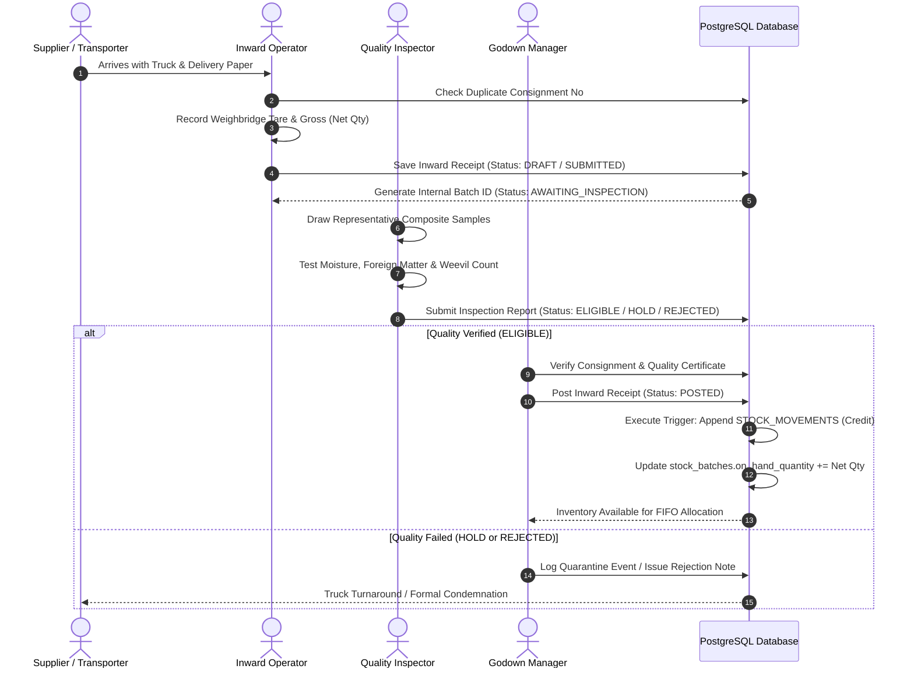
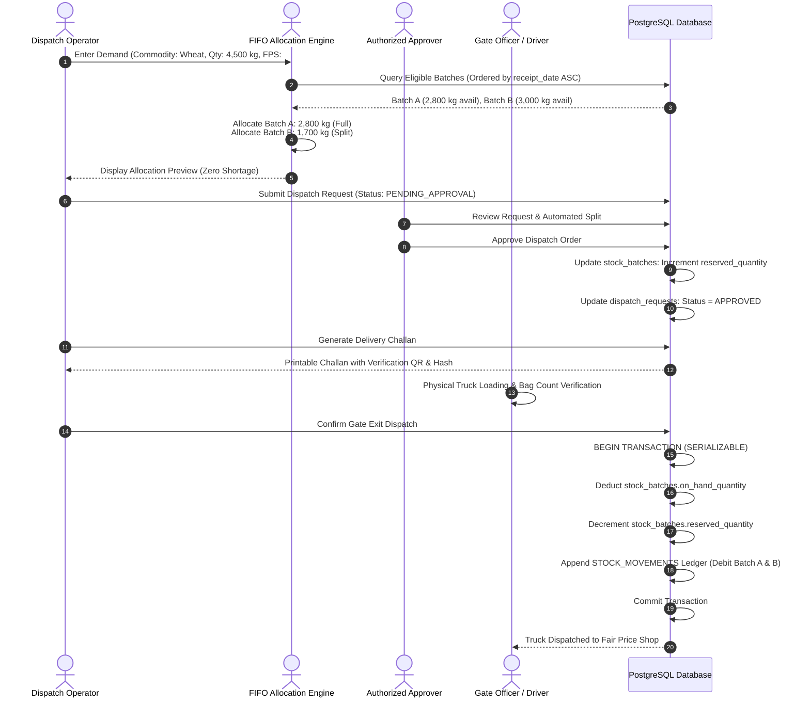

# SmartStock iPDS — Product Requirements & Architectural Specification
**Document Version:** 1.0.0-PROTOTYPE-PLAN  
**Status:** Read-Only Research, Product Planning & System Architecture Specification (Phase 0)  
**Target Milestone:** Hackathon-Ready Functional Prototype & Production-Grade Architectural Foundation  
**Authors:** Antigravity Unified Product & Engineering Leadership Council  
*(Product Management, Public Distribution System Domain Specialists, Principal Software Architects, Senior Frontend & Backend Architects, Database Architects, Security & Cryptography Engineers, FIFO & Inventory Specialists, PWA & Offline Synchronization Engineers, QA & Test Automation Leads, Accessibility & UI/UX Designers, DevOps & Reliability Engineers, Technical Documentation Specialists)*  
**Document Scope:** Repository Root Only (`projectidea.md`) — Zero Application Code Generated  

---

## Table of Contents
1. [Project Title and Version](#1-project-title-and-version)
2. [Executive Summary](#2-executive-summary)
3. [Problem Statement & Business Context](#3-problem-statement--business-context)
4. [Existing-System Research & Domain Precedents](#4-existing-system-research--domain-precedents)
5. [Product Vision and Measurable Objectives](#5-product-vision-and-measurable-objectives)
6. [Target Users and Stakeholders](#6-target-users-and-stakeholders)
7. [In-Scope and Out-of-Scope Boundaries](#7-in-scope-and-out-of-scope-boundaries)
8. [Public and Internal Information Architecture](#8-public-and-internal-information-architecture)
9. [Roles and Responsibilities](#9-roles-and-responsibilities)
10. [Detailed Role and Permission Matrix](#10-detailed-role-and-permission-matrix)
11. [Jurisdiction and Data-Scope Model](#11-jurisdiction-and-data-scope-model)
12. [Authentication and Authorization Architecture](#12-authentication-and-authorization-architecture)
13. [Product Navigation and Complete Page Inventory](#13-product-navigation-and-complete-page-inventory)
14. [Major Functional Modules (P0)](#14-major-functional-modules-p0)
15. [Minor Features & Operational Enhancements (P1)](#15-minor-features--operational-enhancements-p1)
16. [End-to-End Business Workflows](#16-end-to-end-business-workflows)
17. [Deterministic FIFO Algorithm & Eligibility Engine](#17-deterministic-fifo-algorithm--eligibility-engine)
18. [Stock Balance Types, Reservations & Dispatch Lifecycle](#18-stock-balance-types-reservations--dispatch-lifecycle)
19. [Exception Handling & Separation-of-Duties Approvals](#19-exception-handling--separation-of-duties-approvals)
20. [Database Architecture & Entity Inventory](#20-database-architecture--entity-inventory)
21. [Data Integrity, Concurrency & Transaction Strategy](#21-data-integrity-concurrency--transaction-strategy)
22. [Integration Strategy & External System Boundaries](#22-integration-strategy--external-system-boundaries)
23. [Progressive Web App (PWA) & Offline Synchronization](#23-progressive-web-app-pwa--offline-synchronization)
24. [Security, Threat Modeling & Privacy Engineering](#24-security-threat-modeling--privacy-engineering)
25. [Reporting Engine, Ledger Audits & Notification Rules](#25-reporting-engine-ledger-audits--notification-rules)
26. [UI/UX Design System, Accessibility & Localization](#26-uiux-design-system-accessibility--localization)
27. [Technology Stack & Free-Tier Operational Feasibility](#27-technology-stack--free-tier-operational-feasibility)
28. [Test Strategy & Testable Acceptance Criteria](#28-test-strategy--testable-acceptance-criteria)
29. [Synthetic Demo Dataset & Judge Demonstration Script](#29-synthetic-demo-dataset--judge-demonstration-script)
30. [Phased Development Roadmap](#30-phased-development-roadmap)
31. [Risk Register, Mitigation Strategies & Open Questions](#31-risk-register-mitigation-strategies--open-questions)
32. [Assumptions & Unverified Working Decisions](#32-assumptions--unverified-working-decisions)
33. [Domain Glossary](#33-domain-glossary)
34. [Research References & Source Verification](#34-research-references--source-verification)
35. [Definition of Done for Planning Phase](#35-definition-of-done-for-planning-phase)

---

## 1. Project Title and Version

### 1.1 Project Identifier
- **Official Title:** SmartStock iPDS
- **Expanded Formal Name:** Smart Commodity Stock Allocation and FIFO Management System for the Public Distribution System
- **Document Release:** Version 1.0.0-PROTOTYPE-PLAN (Phase 0 Architectural Planning Release)
- **Target Application Profile:** Responsive Progressive Web App (PWA) with enterprise-grade authorization, local draft persistence, and transactional backend integration.
- **Project Repository:** BhandaarSetu (Root Documentation Baseline)

---

## 2. Executive Summary

### 2.1 The Strategic Problem
The Public Distribution System (PDS) in India constitutes one of the largest food security networks in the world, distributing millions of metric tonnes of staple food grains (primarily wheat and rice, alongside sugar, pulses, salt, and fortified edible oils) annually across hundreds of thousands of Fair Price Shops (FPS). Within intermediate storage facilities—State Civil Supplies Corporation buffer godowns, Central Warehousing Corporation (CWC) units, State Warehousing Corporation (SWC) godowns, and hired base depots—stock arrives continuously in staggered consignments across multiple weeks and harvest seasons.

Under conventional manual or semi-digitalized warehouse operations, warehouse floor staff frequently dispatch stock based on physical accessibility rather than chronological arrival. Bags placed near godown bay doors during recent inward deliveries are unloaded first ("Last In, First Out by physical convenience"). Older grain stored deeper in godown stacks remains untouched, exceeding safe storage windows and resulting in weevil infestation, moisture absorption, nutritional degradation, and eventual condemnation as unfit for human consumption. Concurrently, manual stock registers suffer from clerical rounding errors, untraced stock adjustments, lack of batch-level pedigree, and vulnerable dispatch workflows susceptible to diversion.

### 2.2 The Proposed Solution
**SmartStock iPDS** is a modern, responsive, offline-resilient Progressive Web App designed specifically for intermediate warehouse operators, godown managers, quality inspectors, district supply officers, and department leadership. The platform digitizes stock receipt, enforces automated quality clearance workflows, calculates deterministic First-In, First-Out (FIFO) multi-batch allocations, generates tamper-evident digital Delivery Challans, and maintains an immutable double-entry stock movement ledger. 

Crucially, SmartStock iPDS provides strict **Four-Eyes Separation of Duties** for approvals and formalizes **FIFO Exceptions**—ensuring that if an older eligible batch must be bypassed due to physical stack obstruction or localized handling constraints, a mandatory justification is captured, logged, and escalated for independent administrative clearance.

```
       [ Staggered Commodity Inward ]
                     │
                     ▼
       [ Inward Draft & Physical Unloading ]
                     │
                     ▼
       [ Quality Inspection Gating ]
      ┌──────────────┴──────────────┐
      ▼                             ▼
 [ Quality Hold / Reject ]    [ Eligible Batch ]
                                    │
                                    ▼
       [ FPS Dispatch Demand Received ]
                     │
                     ▼
   [ Deterministic FIFO Allocation Engine ]
         (Oldest Receipt Date First)
                     │
         ┌───────────┴───────────┐
         ▼                       ▼
  [ Normal FIFO Path ]    [ FIFO Exception Path ]
         │                       │
         │                (Mandatory Reason
         │                 & Dual Approval)
         └───────────┬───────────┘
                     ▼
       [ Dispatch Approval & Stock Reservation ]
                     │
                     ▼
     [ Loading, Challan Generation & Confirmed Exit ]
                     │
                     ▼
   [ Double-Entry Stock Movement Ledger Posted ]
```

### 2.3 Strict Cost and Zero-Budget Prototype Feasibility
To ensure complete accessibility for hackathon demonstration, civic innovation, and academic peer review, SmartStock iPDS is architected to run **100% on free-tier development and hosting platforms**:
- **Frontend & App Shell:** React + TypeScript + Vite + Tailwind CSS, hosted on Vercel or Netlify free tiers.
- **Database & Authentication:** PostgreSQL managed via Supabase Free Tier, leveraging native Row Level Security (RLS) and built-in GoTrue authentication.
- **Offline Operations:** Service Workers and browser IndexedDB via standard W3C APIs (zero paid offline synchronization licenses).
- **Zero Cost AI/Notification Policy:** Deterministic inventory logic replaces black-box AI APIs; in-app notification centers replace paid commercial SMS gateways.

Free-tier limitations (e.g., Supabase project pausing after 7 days of inactivity, 500 MB database quota, 50,000 monthly active users) are explicitly accounted for in operational runbooks, ensuring zero unexpected financial liability during evaluation.

---

## 3. Problem Statement & Business Context

### 3.1 Domain Reality: The Warehouse Floor
A typical district civil supplies godown handles thousands of quintals of grain stored in standard 50 kg jute or HDPE (High-Density Polyethylene) bags organized in rectangular stacks. A single godown receives stock from:
1. Direct farmer procurement centers (Mandis) during Rabi/Kharif harvest windows.
2. Inter-state rakes dispatched by the Food Corporation of India (FCI).
3. Millers delivering Custom Milled Rice (CMR).
4. Refined oil and fortified salt suppliers under state nutritional schemes.

Because procurement and rake arrivals occur intermittently, a godown inevitably stores multiple consignments of the exact same commodity received on different dates under varying ambient storage conditions:

| Commodity | Packaging Type | Typical Stack Height | High-Risk Factor | Consequence of Storage Delay |
| :--- | :--- | :--- | :--- | :--- |
| **Wheat (Grade A)** | 50 kg Jute Bag | 16–18 layers | Moisture, khapra beetle | Rot, loss of baking quality, caking |
| **Rice (Parboiled/Raw)**| 50 kg HDPE Bag | 18–20 layers | Yellowing, weevils, broken grain| Discoloration, foul odor, beneficiary rejection |
| **Refined Sugar** | 50 kg Polylined | 14–16 layers | Relative humidity (>70%) | Moisture absorption, melting, microbial growth |
| **Fortified Edible Oil**| 15 kg/L Tin/Pouch| Stacked Crates | Rancidity, seal leakage | Free fatty acid increase, oxidative spoilage |
| **Chana / Tuvar Dal** | 50 kg Jute Bag | 14–16 layers | Pulse beetle (bruchids) | Hollowed grains, weight loss, protein degradation |

### 3.2 Operational Failures in Conventional Management
Without automated, tamper-resistant digital tracking, five critical systemic failures emerge:

1. **LIFO Bias & Stock Ageing:** Warehouse laborers prefer unstacking the newest arrivals nearest the delivery bay doors. Old stock positioned at the rear of godown bays remains stationary for 6 to 18 months, crossing safe storage limits and degrading into unserviceable waste.
2. **Untraced Manual Adjustments:** When physical stock does not match the paper ledger, operators make arbitrary manual balance reductions ("handling loss", "transit moisture loss") without independent inspection, masking pilferage or improper storage practices.
3. **Quality Bypass:** Consignments placed on quarantine or moisture-hold pending chemical analysis are inadvertently or intentionally loaded onto trucks during high-pressure dispatch cycles.
4. **Lack of Split-Batch Accounting:** When an FPS demands 45 quintals (4,500 kg) and the oldest available batch has only 28 quintals (2,800 kg), manual challans frequently record only a single batch number, obscuring the physical origin of the remaining 17 quintals (1,700 kg).
5. **Vulnerable Delivery Challans:** Paper delivery challans lack cryptographic verification, enabling fraudulent duplicate deliveries, altered truck registration numbers, or diverted consignments.

### 3.3 Proposed Business Solution & Measurable Benefits
SmartStock iPDS introduces an end-to-end digital control framework:
- **Deterministic Batch-Wise FIFO Engine:** Automatically splits demand orders across oldest eligible batches with sub-millisecond execution.
- **Hard Quality Gating:** Held or rejected batches cannot be selected by the allocation engine under any standard dispatch configuration.
- **Append-Only Movement Ledger:** Physical stock balances are never updated directly via UI field edits; every balance change requires an immutable debit or credit ledger movement.
- **Four-Eyes Verification:** Staff who initiate dispatches or inward drafts cannot approve their own transactions.
- **Auditable FIFO Exception Registry:** Any deviation from FIFO ordering requires an authorized administrative override with attached photographic evidence and reason logging.

```
Expected Business Metrics:
├── Grain Spoilage Due to Over-Ageing: 0% within system-managed godowns
├── Dispatch Traceability: 100% of dispatched kilograms mapped to specific batch IDs
├── Allocation Computation Time: < 50 milliseconds per multi-batch order
├── Reconciliation Discrepancy Window: Reduced from monthly paper audits to real-time daily cycle counts
└── Audit Trail Coverage: 100% of state transitions captured with immutable actor/timestamp stamps
```

---

## 4. Existing-System Research & Domain Precedents

To ground the software in realistic public-sector supply-chain contexts, the planning council conducted read-only research across official departmental portals, statutory guidelines, security standards, and modern web specifications.

### 4.1 Department of Food and Public Distribution (DFPD)
- **Source:** [DFPD Orders & Distribution Guidelines](https://dfpd.gov.in/distribution-of-food-grains/en) *(Inspected October 2026)*
- **Key Domain Insights:**
  - DFPD issues monthly central allocation orders across Targeted Public Distribution System (TPDS) schemes, Pradhan Mantri Garib Kalyan Anna Yojana (PMGKAY), and Other Welfare Schemes (OWS).
  - Allocation is calculated per state based on verified beneficiary counts across Antyodaya Anna Yojana (AAY) and Priority Household (PHH) categories.
  - States receive strict lifting deadlines (typically the last day of the preceding month for the subsequent allocation cycle). Warehouses must maintain an active buffer stock while ensuring steady turnover.
- **Research Constraint Recorded:** DFPD public web pages utilize dynamic client-side DOM rendering (`GetContentPage(...)`). While public circulars and allocation orders are published as PDF notifications, DFPD does not provide open, public REST APIs for direct external programmatic integration.

### 4.2 Food Corporation of India (FCI) & ANNA DARPAN
- **Source:** [FCI Annual Report 2024–25 & Modernization Circulars](https://fci.gov.in) *(Inspected October 2026)*
- **Key Domain Insights:**
  - FCI is actively phasing out its legacy **Depot Online System (DOS)**, replacing it with **ANNA DARPAN** (contract awarded to M/s Coforge Limited in June 2024).
  - ANNA DARPAN is designed as a cloud-hosted, microservices-based, mobile-first logistics and depot management platform covering procurement centers, railheads, depots, and storage silos.
  - Modernization initiatives also include **Anna Chakra** (route and supply-chain optimization developed with IIT Delhi and the UN World Food Programme) and IP-based CCTV warehouse surveillance.
- **Research Constraint Recorded:** ANNA DARPAN is an internal, secure, enterprise government platform. There are no public API endpoints, open sandboxes, or published developer documentation. SmartStock iPDS must therefore be built as an **independently functional, self-contained warehouse management system** that exposes standard CSV and REST adapter boundaries rather than attempting unauthorized direct integration with FCI infrastructure.

### 4.3 State NFSA Portals (e.g., NFSA Haryana)
- **Source:** [NFSA State Portal Haryana](https://www.nfsa.gov.in/State/HR) *(Inspected October 2026)*
- **Key Domain Insights:**
  - State portals track allocation orders, lifting progress from FCI godowns to state storage depots, issuance of truck challans, and distribution to FPS dealers.
  - Haryana's ePDS portal (`epds.haryanafood.gov.in`) publishes public allocation and lifting reports. However, underlying transactional database schemas vary significantly between states (e.g., NIC-developed state portals vs. custom state-specific software).
- **Research Constraint Recorded:** Publicly visible web reports do not imply authorization to connect to back-end databases. Integration must be modeled on clean import/export specifications, recognizing that state workflows diverge in administrative hierarchy and nomenclature.

### 4.4 OWASP Authorization & Access Control
- **Source:** [OWASP Authorization Cheat Sheet](https://cheatsheetseries.owasp.org/cheatsheets/Authorization_Cheat_Sheet.html)
- **Architectural Tenets Adopted:**
  - **Default Deny:** All routes, endpoints, and database tables deny access unless an explicit grant rule exists.
  - **Context-Bound Authorization:** Validating role alone is insufficient. The system must verify the actor's *jurisdiction scope* (Organization -> State -> District -> Godown) against the requested resource identifier.
  - **Zero Trust in Client State:** Hiding a button or menu in the React UI is strictly an aesthetic/usability measure; every mutation and query must be authorized on the server/database layer.
  - **Anti-IDOR:** Direct object references (e.g., `/api/challans/UUID`) must undergo server-side validation against the caller's authorized godown scope to prevent Insecure Direct Object References.

### 4.5 PostgreSQL & Supabase Row Level Security (RLS)
- **Source:** [Supabase RLS & Secure Data Guidelines](https://supabase.com/docs/guides/database/postgres/row-level-security)
- **Database Engineering Rules Adopted:**
  - Enable RLS on 100% of exposed database tables. Tables without RLS are completely vulnerable to read/write manipulation via the public `anon` API key.
  - Separate `USING` clauses (which filter readable/deletable rows) from `WITH CHECK` clauses (which validate inserted/updated row data).
  - Optimize query plan performance: Wrap context function calls in subqueries—`((SELECT auth.uid()) = user_id)`—preventing PostgreSQL from re-executing functions per row scan.
  - Index every foreign key and tenant scoping column used inside RLS policies (`godown_id`, `district_id`, `org_id`).
  - Maintain the `service_role` key strictly in protected backend environments; never expose it to frontend JavaScript bundles.

### 4.6 PWA Offline Architecture & MDN Guidelines
- **Source:** [MDN Web Docs: PWA Offline & Background Operation](https://developer.mozilla.org/en-US/docs/Web/Progressive_web_apps/Guides/Offline_and_background_operation)
- **PWA Tenets Adopted:**
  - Cache-First strategy for static application shell assets (HTML, CSS, JS, SVG icons).
  - Network-First strategy for operational stock queries with fallback to read-only stale cached views marked with a prominent `[OFFLINE - STALE DATA]` warning banner.
  - Client-side IndexedDB used exclusively for local draft storage (Inward drafts, physical count worksheets).
  - Strict Operational Restriction: **Authoritative stock deductions, final dispatch confirmations, and privileged approvals must NEVER execute offline.** They require server-side database serialization.

### 4.7 Digital Personal Data Protection (DPDP) Rules, 2025
- **Source:** [Ministry of Electronics & Information Technology (MeitY) DPDP Guidelines](https://www.meity.gov.in)
- **Privacy & Compliance Tenets Adopted:**
  - **Data Minimization:** SmartStock iPDS is strictly an *intermediate warehouse inventory system*. It intentionally **does not collect, process, or store beneficiary Aadhaar numbers, ration card numbers, biometric templates, or family demographics**.
  - Internal staff personal data is limited to operational necessities: Full Name, Official Government Email, Phone Number (for account recovery), Designation, and Assigned Jurisdiction.
  - Explicit consent and audit logging for all administrative data mutations.

---

## 5. Product Vision and Measurable Objectives

### 5.1 Vision Statement
To establish the gold standard for public-sector warehouse inventory software by delivering a transparent, deterministic, zero-cost, and tamper-resistant digital platform that ensures food grains reach fair price shops according to strict scientific storage and FIFO principles.

### 5.2 Measurable Objectives (Goals A through O)

```
┌────────────────────────────────────────────────────────────────────────────────────────┐
│                        SMARTSTOCK iPDS — CORE GOALS MATRIX                             │
├─────────────────────┬──────────────────────────────────────────────────────────────────┤
│ Goal A: Accounting │ 100% double-entry movement ledger. No arbitrary balance changes.  │
│ Goal B: Traceability│ Batch-level tracking from inward consignment to outward challan. │
│ Goal C: FIFO Engine │ Deterministic allocation; oldest eligible stock allocated first. │
│ Goal D: Quality Gate│ Quarantine/Hold segregation. Ineligible stock cannot be chosen.  │
│ Goal E: Approvals   │ Enforce four-eyes principle on dispatches and adjustments.       │
│ Goal F: Challans    │ Unique, cryptographically signed, printable delivery challans.   │
│ Goal G: Ledger Audit│ Immutable, append-only transaction history with actor IDs.       │
│ Goal H: Ageing Warn │ Configurable threshold alerts for stock approaching limit.       │
│ Goal I: Exceptions  │ Mandatory reason logging & supervisor approval for FIFO bypass.  │
│ Goal J: Reports     │ Instant generation of stock registers, challan summaries, ledger.│
│ Goal K: Scoped RBAC │ Hierarchical jurisdiction enforcement (State->District->Godown). │
│ Goal L: Mobile PWA  │ Installable, responsive UI with touch targets >= 44x44px.        │
│ Goal M: Safe Offline│ Local IndexedDB draft capture; authoritative server-side commit. │
│ Goal N: Zero Budget │ Functional on Supabase/Vercel free tiers; 0 paid dependencies.   │
│ Goal O: Integration │ Ready for CSV batch import/export & future REST API adapters.    │
└─────────────────────┴──────────────────────────────────────────────────────────────────┘
```

---

## 6. Target Users and Stakeholders

SmartStock iPDS serves distinct user personas across state food supply directorates, district administrative offices, warehouse facilities, and civic oversight bodies.

```
                      [ State Food & Supplies Dept ]
                                    │
                        [ Department / State Admin ]
                                    │
                                    ▼
                      [ District Supply Officer (DSO) ]
                                    │
                  ┌─────────────────┴─────────────────┐
                  ▼                                   ▼
          [ Godown Manager ]                  [ District Auditor ]
                  │
        ┌─────────┴─────────┐
        ▼                   ▼
[ Inward Operator ]  [ Dispatch Operator ]
        │                   │
        ▼                   ▼
[ Quality Inspector ][ Authorized Approver ]
```

### 6.1 Internal Operational Stakeholders
1. **Platform Super Admin:** Technical platform maintainer responsible for tenant provisioning, system health monitoring, and security event review. Operates outside business transactions.
2. **Department / State Admin:** Highest administrative business authority. Configures commodity masters, ageing thresholds, organizational structures, and district boundaries; reviews statewide inventory and publishes authorized transparency reports.
3. **District Supply Officer (DSO):** Oversees food grain administration within an assigned revenue district. Reviews district-level buffer stock, approves escalated FIFO exceptions, and inspects godown operations.
4. **Godown Manager:** Primary custodian of an assigned physical warehouse facility. Supervises inward receipts, monitors daily stack movements, conducts physical cycle counts, and manages floor personnel.
5. **Stock Inward Operator:** Warehouse tally clerk who captures truck arrivals, unloads consignments, verifies physical delivery notes, and creates inward receipt drafts.
6. **Quality Inspector:** Certified food analyst or technical assistant who samples consignments, conducts moisture and refractions tests, records laboratory results, and sets batch eligibility (Awaiting Inspection, Eligible, Hold, Rejected).
7. **Dispatch Operator:** Logistics clerk who receives FPS quota demand orders, executes the FIFO allocation preview, generates draft challans, and supervises truck loading.
8. **Authorized Approver:** Senior departmental officer (Assistant Food Supplies Officer or Godown In-Charge) delegated with statutory authority to approve dispatches, stock adjustments, and reversals.
9. **Auditor / Vigilance Inspector:** Independent inspection officer conducting physical audits, reviewing variance registers, and investigating FIFO compliance logs.

### 6.2 External & Future Stakeholders
10. **Public Visitor / Citizen:** Unauthenticated member of the public seeking verified, published transparency reports regarding district grain reserves and monthly distribution metrics.
11. **Fair Price Shop (FPS) Recipient *(Future Phase P2)*:** Licensed dealer who views approved delivery challans assigned to their shop, tracks dispatch trucks, and submits delivery receipts.
12. **Commercial Supplier / Transporter *(Future Phase P2)*:** Delivery contractor who checks consignment unloading status and gate-in pass history.

---

## 7. In-Scope and Out-of-Scope Boundaries

To maintain rigorous architectural discipline and ensure zero-cost prototype feasibility, the functional scope is strictly delineated.

```
┌──────────────────────────────────────────────┬──────────────────────────────────────────────┐
│             IN-SCOPE (MVP & P1)              │           STRICTLY OUT-OF-SCOPE              │
├──────────────────────────────────────────────┼──────────────────────────────────────────────┤
│ Multi-batch commodity stock accounting       │ Real government production system writes     │
│ Batch-level internal ID & pedigree tracking  │ Official government security certification   │
│ Deterministic FIFO allocation calculation    │ Beneficiary ration-card or Aadhaar tracking │
│ Quality-aware status gating & hold quarantine│ Biometric / Iris authentication at FPS      │
│ Inward receipt creation & verification       │ Financial subsidy settlement & cash accounts │
│ Digital delivery challan generation (PDF)    │ Commercial paid SMS / WhatsApp notifications │
│ Double-entry append-only movement ledger     │ Hardware weighbridge / IoT automated sensors │
│ FIFO exception logging & dual-tier approvals │ Automated claims of statutory legal sanction │
│ Physical cycle counts & variance adjustments │ Native Google Play / Apple App Store apps    │
│ PWA installability & offline draft capture   │ Commercial / Paid AI API subscriptions       │
│ Role-based & jurisdiction-based data scoping │ Direct database connections to state portals │
│ Approved public transparency snapshots       │ Scraping unauthenticated government portals  │
└──────────────────────────────────────────────┴──────────────────────────────────────────────┘
```

---

## 8. Public and Internal Information Architecture

SmartStock iPDS enforces a strict, architectural bifurcation between unauthenticated public access and authenticated internal operational workflows.

```
                                  [ Incoming Web Request ]
                                             │
                       ┌─────────────────────┴─────────────────────┐
                       ▼                                           ▼
             [ Unauthenticated Route ]                   [ Authenticated Route ]
                       │                                           │
             [ Public Gateway Engine ]                   [ Supabase Auth & JWT ]
                       │                                           │
         ┌─────────────┴─────────────┐                             ▼
         ▼                           ▼                   [ Jurisdiction Scope Gate ]
  [ Public Landing ]       [ Published Reports ]                   │
  (Overview, Help,         (Read-Only Pre-Rendered                 ▼
   Sign-in Gateway)         Authorized Snapshots)        [ PostgreSQL RLS Enforcement ]
                                                                   │
                                                                   ▼
                                                         [ Internal Application Area ]
                                                         (Godown Operations, Ledger,
                                                          Approvals, Quality, Admin)
```

### 8.1 The Public Area
- **Accessibility:** Accessible by anonymous visitors without credentials.
- **Allowed Pages:**
  - Public Landing Page (`/`): High-level project mission, overview of FIFO methodology, and access portal.
  - Public Transparency Portal (`/transparency`): Displays **only explicitly published, pre-aggregated report snapshots** released by authorized State Administrators.
  - System Verification & Help (`/help`): Public documentation regarding grain quality norms, FIFO policies, and prototype architecture.
  - Sign-In Page (`/login`): Secure authentication gateway for authorized departmental personnel.
- **Strict Privacy Controls:**
  - Anonymous visitors have **zero access** to operational tables, live batch inventories, individual warehouse stacks, employee profiles, draft challans, or internal security audit logs.
  - Public reports query a dedicated `published_reports` table populated exclusively via an authorized administrative publication workflow. Operational database tables are protected by RLS policies that reject anonymous (`anon`) queries by default.

### 8.2 The Internal Area
- **Accessibility:** Authenticated staff only, verified via secure JWT and mapped to an active `user_profiles` record.
- **Access Principles:**
  - **Dynamic Navigation:** The navigation sidebar dynamically renders only those modules permitted by the user's role and organizational scope.
  - **Defense-in-Depth:** Client-side route guards prevent unauthorized view transitions; server-side database RLS policies prevent unauthorized data extraction even if client-side checks are tampered with.
  - **Zero Self-Registration:** Public users cannot create administrative or operational accounts. All internal accounts are provisioned by State or Platform Administrators via an invitation workflow.

---

## 9. Roles and Responsibilities

Each role within SmartStock iPDS possesses strictly defined operational boundaries, data visibility scopes, and transactional constraints.

### 9.1 Role Specifications

#### ROLE 1: PUBLIC VISITOR
- **Allowed Pages:** `/`, `/login`, `/transparency`, `/help`.
- **Allowed Scope:** Global public domain only.
- **Permissions:** Read-only access to published reports and general system documentation.
- **Prohibited Actions:** Viewing live warehouse stock, accessing internal forms, registering accounts, executing mutations.

#### ROLE 2: PLATFORM SUPER ADMIN
- **Allowed Pages:** `/admin/system`, `/admin/tenants`, `/admin/health`, `/admin/security-logs`.
- **Allowed Scope:** Platform-wide technical infrastructure.
- **Permissions:** Manage system settings, monitor database connection pools, inspect error logs, provision organization accounts.
- **Prohibited Actions:** **Must not approve business transactions** (dispatches, receipts, adjustments); must not directly edit stock balances. Any exceptional data access is strictly logged in audit tables.

#### ROLE 3: DEPARTMENT / STATE ADMIN
- **Allowed Pages:** `/dashboard/state`, `/masters/*`, `/users/*`, `/reports/*`, `/transparency/publish`.
- **Allowed Scope:** Statewide organizational jurisdiction (`state_id`).
- **Permissions:** Create/update district and godown masters, configure commodity ageing thresholds, manage staff assignments, review statewide stock reports, authorize and publish public transparency snapshots.
- **Prohibited Actions:** Altering immutable audit records, silently modifying posted stock movements, approving facility-level floor receipts without godown assignment.

#### ROLE 4: DISTRICT SUPPLY OFFICER (DSO)
- **Allowed Pages:** `/dashboard/district`, `/godowns`, `/inventory/district`, `/approvals/district-escalations`, `/reports/*`.
- **Allowed Scope:** Assigned district jurisdiction (`district_id`).
- **Permissions:** View aggregated inventory across all godowns in the district; review dispatch histories and FIFO compliance rates; review and approve escalated FIFO exceptions (>15% variance or high-priority stock); approve significant physical stock adjustments.
- **Prohibited Actions:** Accessing godowns in other districts; directly overriding quality holds; performing direct warehouse floor entries.

#### ROLE 5: GODOWN MANAGER
- **Allowed Pages:** `/dashboard/godown`, `/inventory/*`, `/inward/*`, `/dispatch/*`, `/quality/*`, `/cycle-count/*`, `/reports/*`.
- **Allowed Scope:** Assigned godown(s) (`godown_id`).
- **Permissions:** Monitor real-time stack inventory; review inward drafts; assign inspection tasks; review FIFO dispatch proposals; initiate cycle count requests; approve routine operational adjustments within delegated thresholds.
- **Prohibited Actions:** Approving their own self-created dispatch or inward requests (Four-Eyes violation); bypassing quality holds; modifying immutable ledger entries.

#### ROLE 6: STOCK INWARD OPERATOR
- **Allowed Pages:** `/inward`, `/inward/new`, `/inward/[id]`, `/inventory/batches`.
- **Allowed Scope:** Assigned godown floor (`godown_id`).
- **Permissions:** Create inward receipt drafts; enter consignment details (supplier, commodity, vehicle number, bag count, gross/tare/net weight); attach delivery challan images; submit inward receipts for quality inspection.
- **Prohibited Actions:** Posting stock directly to available inventory; releasing uninspected stock; approving inward drafts; modifying posted receipts.

#### ROLE 7: QUALITY INSPECTOR
- **Allowed Pages:** `/quality`, `/quality/inspect/[receipt_id]`, `/quality/history`.
- **Allowed Scope:** Assigned godown(s) or district testing laboratory.
- **Permissions:** Inspect received consignments; record laboratory refraction parameters (moisture %, foreign matter %, weeviled grain %, broken grain %); transition batch quality status (`AWAITING_INSPECTION` -> `ELIGIBLE` / `QUALITY_HOLD` / `REJECTED`); attach inspection certificates.
- **Prohibited Actions:** Modifying receipt weight/quantity; overriding dispatch allocation rules; deleting inspection history; marking rejected stock as eligible without documented re-inspection.

#### ROLE 8: DISPATCH OPERATOR
- **Allowed Pages:** `/dispatch`, `/dispatch/new`, `/dispatch/[id]`, `/challans/*`.
- **Allowed Scope:** Assigned godown floor (`godown_id`).
- **Permissions:** Create dispatch requests based on authorized FPS quota orders; trigger deterministic FIFO allocation engine; preview multi-batch splits; enter transporter and truck registration details; submit dispatch orders for approval; print authorized delivery challans upon approval; confirm physical gate dispatch.
- **Prohibited Actions:** Approving dispatch requests; manually overriding batch allocations without an approved FIFO exception; dispatching stock on quality hold; modifying challans after gate-exit confirmation.

#### ROLE 9: AUTHORIZED APPROVER
- **Allowed Pages:** `/approvals`, `/approvals/dispatch/[id]`, `/approvals/adjustments/[id]`, `/approvals/exceptions/[id]`.
- **Allowed Scope:** Assigned godown or district hierarchy.
- **Permissions:** Review pending dispatch requests and automated FIFO split proposals; approve or reject dispatches; evaluate FIFO exception justifications; approve cycle-count physical adjustments; sign off on corrective reversal transactions.
- **Prohibited Actions:** Approving transactions they originated; overriding quality holds; bypassing database validation constraints.

#### ROLE 10: AUDITOR / INSPECTOR
- **Allowed Pages:** `/audit/ledger`, `/audit/fifo-compliance`, `/audit/variance`, `/reports/*`.
- **Allowed Scope:** Assigned district or statewide vigilance jurisdiction.
- **Permissions:** Read-only access to all stock movements, historical batch registers, FIFO exception records, approval histories, and immutable audit logs; export audit reports to CSV/PDF.
- **Prohibited Actions:** Strict read-only role. Prohibited from creating, editing, approving, or deleting any operational transaction.

#### ROLE 11: FPS RECIPIENT *(Future Phase P2)*
- **Allowed Scope:** Assigned Fair Price Shop record (`fps_id`).
- **Permissions:** View delivery challans consigned to their specific shop; verify truck dispatch status; record physical receipt acknowledgment.
- **Prohibited Actions:** Viewing warehouse stock balances, accessing other shops' challans, altering warehouse inventory.

#### ROLE 12: SUPPLIER USER *(Future Phase P2)*
- **Allowed Scope:** Assigned supplier record (`supplier_id`).
- **Permissions:** View status of delivered consignments and verified gate-in receipts.
- **Prohibited Actions:** Accessing godown inventory, viewing competitor deliveries, modifying warehouse registers.

---

## 10. Detailed Role and Permission Matrix

The following matrix formally defines the operational authorization boundaries across all system entities.

```
OPERATIONAL PERMISSIONS CODING:
[V]iew | [C]reate Draft | [E]dit Draft | [S]ubmit | [A]pprove | [R]eject | [P]ublish | E[X]port | [C]ancel Draft | Re[V]erse | Hard [D]elete
```

| Entity / Operation | Public Visitor | Platform Super Admin | State / Dept Admin | District Supply Officer | Godown Manager | Stock Inward Operator | Quality Inspector | Dispatch Operator | Authorized Approver | Auditor / Inspector |
| :--- | :---: | :---: | :---: | :---: | :---: | :---: | :---: | :---: | :---: | :---: |
| **Public Landing & Help** | V | V | V | V | V | V | V | V | V | V |
| **Published Transparency Reports**| V | V | V | V | V | V | V | V | V | V |
| **Master Data (Commodity, Godown)**| — | V | V, C, E, A | V | V | V | V | V | V | V |
| **User & Scope Assignments** | — | V, C, E, A | V, C, E, A | V | — | — | — | — | — | V |
| **Inward Receipt Drafts** | — | — | V | V | V, E | V, C, E, S, C| — | — | — | V |
| **Inward Receipt Posting** | — | — | — | — | A, R | — | — | — | A, R | V |
| **Quality Inspections** | — | — | V | V | V | — | V, C, E, S, A| — | — | V |
| **Live Batch Inventory** | — | — | V, X | V, X | V, X | V | V | V | V | V, X |
| **FIFO Dispatch Requests** | — | — | V | V | V | — | — | V, C, E, S, C| — | V |
| **FIFO Exception Requests** | — | — | V | V, A, R | V | — | — | V, C, S | A, R | V |
| **Dispatch Approvals & Reservation**| — | — | — | A, R (Esc) | A, R | — | — | — | A, R | V |
| **Delivery Challan Generation** | — | — | V, X | V, X | V, X | — | — | V, C, X | V, X | V, X |
| **Confirmed Gate Dispatch** | — | — | — | — | V | — | — | S | A | V |
| **Physical Cycle Counts** | — | — | V | V | V, C, S | — | — | — | — | V |
| **Stock Adjustments** | — | — | A, R (High)| A, R (Med)| V, C, S | — | — | — | A, R | V |
| **Stock Movement Ledger** | — | V (Health)| V, X | V, X | V, X | — | — | — | V, X | V, X |
| **Audit Logs** | — | V, X | V, X | V, X | V | — | — | — | V | V, X |
| **Publish Transparency Reports**| — | — | P, C | — | — | — | — | — | — | — |
| **Hard Database Deletion** | **PROHIBITED FOR ALL ROLES — ALL MOVEMENTS & POSTED RECORDS ARE IMMUTABLE** |

### 10.1 Fundamental Authorization Rules
1. **Separation of Duties (Four-Eyes Principle):** A user who initiates or drafts a transaction (`created_by`) is strictly barred from approving it (`approved_by`).
2. **Immutability of Financial & Inventory Movements:** Once a stock receipt, confirmed dispatch, or stock adjustment is posted to the ledger, it can **never be edited or deleted**. Corrections must occur via approved contra-reversal movements.
3. **No Direct Balance Manipulation:** The `current_balance` attribute on `stock_batches` is updated exclusively through atomic database triggers executed in response to verified insertions into `stock_movements`.
4. **Audit Immutability:** Audit log tables are strictly append-only. No application role (including Platform Super Admin) possesses `UPDATE` or `DELETE` grants on `audit_logs`.

---

## 11. Jurisdiction and Data-Scope Model

Role-based access control (RBAC) alone is fundamentally insufficient for public administration software. A Godown Manager in Karnal must not view or manage grain inventory in Rohtak, even though both hold the same user role.

SmartStock iPDS enforces a **Hierarchical Jurisdiction-Based Scope Model**:

```
                         [ Organization / Tenant ]
                                     │
                                     ▼
                          [ State Jurisdiction ]
                           (state_id = "HR")
                                     │
                                     ▼
                         [ District Jurisdiction ]
                         (district_id = "HR-KAR")
                                     │
                                     ▼
                          [ Godown Jurisdiction ]
                         (godown_id = "HR-KAR-001")
                                     │
                                     ▼
                          [ Operational Records ]
                      (Batches, Challans, Movements)
```

### 11.1 Tenancy & Scope Entities
1. **Organization (`organization_id`):** Multi-tenant boundary (e.g., Haryana State Civil Supplies Corporation vs. Punjab Food & Civil Supplies).
2. **State (`state_id`):** State-level administrative division.
3. **District (`district_id`):** Revenue district division.
4. **Godown (`godown_id`):** Physical warehouse facility containing stacks and bays.
5. **Operational Scope Mapping (`user_scope_assignments`):** Explicit relational link binding each user to their permitted organizational coordinates.

### 11.2 The Scope Evaluation Algorithm
When an authenticated user requests access to a resource, the system enforces the following deterministic check:

```
FUNCTION evaluate_user_scope(user_id, target_godown_id):
    1. Retrieve user's role and assigned scope from user_scope_assignments.
    2. IF role == 'PLATFORM_SUPER_ADMIN':
           ALLOW IF operation is system_health ELSE DENY
    3. IF role == 'STATE_ADMIN':
           FETCH target_state_id FROM godowns WHERE id = target_godown_id
           IF user.assigned_state_id == target_state_id THEN ALLOW ELSE DENY
    4. IF role in ['DISTRICT_SUPPLY_OFFICER', 'AUDITOR']:
           FETCH target_district_id FROM godowns WHERE id = target_godown_id
           IF user.assigned_district_id == target_district_id THEN ALLOW ELSE DENY
    5. IF role in ['GODOWN_MANAGER', 'INWARD_OPERATOR', 'QUALITY_INSPECTOR', 
                   'DISPATCH_OPERATOR', 'AUTHORIZED_APPROVER']:
           IF target_godown_id IN user.assigned_godown_ids THEN ALLOW ELSE DENY
    6. RETURN DENY (Default Deny Fallthrough)
```

---

## 12. Authentication and Authorization Architecture

### 12.1 Authentication Provider: Supabase Auth
- Built upon hardened, open-source GoTrue OAuth2/OIDC standards.
- User accounts are provisioned via administrative invitation emails containing short-lived cryptographic tokens.
- Passwords must satisfy complexity requirements (minimum 10 characters, upper/lowercase, numeric, special characters).
- Sessions are maintained via secure, `HttpOnly`, `SameSite=Lax` JSON Web Tokens (JWT) with a 60-minute expiry window and automatic refresh token rotation.
- **Zero Public Sign-Up:** The public registration endpoint is explicitly disabled in the Supabase project configuration.

### 12.2 Authorization Enforcement: PostgreSQL Row Level Security (RLS)
Security is enforced directly within the PostgreSQL database engine. Every query executed by the client SDK automatically propagates the user's JWT identity.

```sql
-- Architectural Reference Pattern: Godown-Scoped Table Protection (e.g., stock_batches)
ALTER TABLE stock_batches ENABLE ROW LEVEL SECURITY;

-- 1. Permitted Read Policy (SELECT)
CREATE POLICY "stock_batches_scoped_read_policy"
ON stock_batches
FOR SELECT
TO authenticated
USING (
    godown_id IN (
        SELECT usa.godown_id 
        FROM user_scope_assignments usa
        WHERE usa.user_id = (SELECT auth.uid())
          AND usa.is_active = true
    )
    OR
    EXISTS (
        SELECT 1 
        FROM user_profiles up
        JOIN user_scope_assignments usa ON up.id = usa.user_id
        JOIN godowns g ON g.id = stock_batches.godown_id
        WHERE up.id = (SELECT auth.uid())
          AND up.role_code IN ('STATE_ADMIN', 'DISTRICT_SUPPLY_OFFICER', 'AUDITOR')
          AND (
              (up.role_code = 'STATE_ADMIN' AND usa.state_id = g.state_id)
              OR
              (up.role_code IN ('DISTRICT_SUPPLY_OFFICER', 'AUDITOR') AND usa.district_id = g.district_id)
          )
    )
);

-- 2. Permitted Mutation Policy (INSERT / UPDATE)
CREATE POLICY "stock_batches_scoped_write_policy"
ON stock_batches
FOR INSERT
TO authenticated
WITH CHECK (
    godown_id IN (
        SELECT usa.godown_id 
        FROM user_scope_assignments usa
        JOIN user_profiles up ON up.id = usa.user_id
        WHERE usa.user_id = (SELECT auth.uid())
          AND usa.is_active = true
          AND up.role_code IN ('GODOWN_MANAGER', 'STOCK_INWARD_OPERATOR')
    )
);
```

### 12.3 Service Role Isolation
The PostgreSQL `service_role` credential bypasses all RLS policies. It is **strictly prohibited from inclusion in frontend client code**. It is reserved exclusively for background transactional functions executed in secure serverless environments (Supabase Database Edge Functions) during scheduled ledger reconciliation or automated snapshot publication.

---

## 13. Product Navigation and Complete Page Inventory

The user interface is structured around operational clarity, minimal cognitive load, and high-contrast accessibility.

```
                                [ Product Route Sitemap ]
                                            │
        ┌───────────────────────────────────┼───────────────────────────────────┐
        ▼                                   ▼                                   ▼
 [ Public Domain ]                 [ Operational Domain ]             [ Administrative Domain ]
 ├── / (Landing Page)              ├── /dashboard                      ├── /masters/commodities
 ├── /login (Auth Portal)          ├── /inward (Receipts & Gate-In)    ├── /masters/godowns
 ├── /transparency (Public Data)   ├── /quality (Inspections & Holds)  ├── /masters/fps
 └── /help (Knowledge Base)        ├── /inventory (Batches & Stacks)   ├── /users (Staff Provisioning)
                                   ├── /dispatch (FIFO Orders)         ├── /audit/ledger (Movements)
                                   ├── /approvals (Dual Sign-Off)      ├── /transparency/publish
                                   ├── /challans (Delivery Slips)      └── /admin/system-health
                                   └── /cycle-count (Stock Audits)
```

### 13.1 Detailed Screen Specifications

#### 1. Public Landing Page (`/`)
- **Purpose:** Public orientation, overview of transparent PDS operations, and entry point.
- **Allowed Roles:** All (Unauthenticated & Authenticated).
- **Data Displayed:** System mission, live public status banner, explanation of FIFO grain handling.
- **Primary Actions:** "Access Staff Portal" button, "View Public Transparency Reports" link.

#### 2. Staff Authentication Portal (`/login`)
- **Purpose:** Secure sign-in for departmental officers and warehouse operators.
- **Allowed Roles:** Unauthenticated visitors.
- **Data Displayed:** Email/password credentials form, password reset request link.
- **Primary Actions:** Submit authentication, trigger magic link, toggle high-contrast display.

#### 3. Operational Command Dashboard (`/dashboard`)
- **Purpose:** Centralized operational overview tailored to the user's role and assigned jurisdiction.
- **Allowed Roles:** All authenticated departmental roles.
- **Data Displayed:** Real-time stock by commodity (Metric Tonnes), pending inward receipts, pending dispatch approvals, active quality holds, oldest eligible batches, ageing alerts.
- **Primary Actions:** Quick action shortcuts ("New Inward", "Create Dispatch", "Review Approvals").
- **Responsive Behavior:** Multi-card grid on desktop; single-column stacked accordion on mobile.

#### 4. Stock Inward Register (`/inward`)
- **Purpose:** Tracking all incoming commodity consignments from arrival to stack storage.
- **Allowed Roles:** Godown Manager, Inward Operator, DSO, State Admin, Auditor.
- **Data Displayed:** Paginated table of receipts (Receipt ID, Date, Supplier, Commodity, Vehicle No, Bags, Net Weight, Inspection Status).
- **Primary Actions:** "Create Inward Consignment", filter by supplier/date/status, export CSV.

#### 5. New Consignment Inward Form (`/inward/new`)
- **Purpose:** Capturing truck arrival data and generating internal batch records.
- **Allowed Roles:** Stock Inward Operator, Godown Manager.
- **Data Displayed:** Multi-step form: Consignment Details -> Weight Slip Data -> Document Upload -> Batch Identifier Assignment.
- **Primary Actions:** "Save Local Draft (Offline)", "Submit for Quality Inspection".

#### 6. Quality Inspection Desk (`/quality`)
- **Purpose:** Managing laboratory sampling, refraction analysis, and eligibility certification.
- **Allowed Roles:** Quality Inspector, Godown Manager, DSO, Auditor.
- **Data Displayed:** Batches awaiting inspection, active quality holds, laboratory parameters (Moisture %, Foreign Matter %, Broken Grains %).
- **Primary Actions:** "Record Inspection Outcome", "Release Batch to Eligible", "Place on Quality Hold", "Reject Consignment".

#### 7. Live Batch Inventory & Stack Register (`/inventory`)
- **Purpose:** Comprehensive batch-wise tracking of all stock within the authorized godown.
- **Allowed Roles:** All authenticated operational roles.
- **Data Displayed:** Internal Batch ID, Commodity, Stack Location, Receipt Date, Age (Days), On-Hand Qty, Reserved Qty, Available Qty, Quality Status, Ageing Alert Badge.
- **Primary Actions:** Search by Batch ID, filter by eligibility, inspect batch pedigree.

#### 8. FIFO Dispatch Planner & Execution (`/dispatch/new`)
- **Purpose:** Generating deterministic multi-batch dispatch allocations against FPS quota orders.
- **Allowed Roles:** Dispatch Operator, Godown Manager.
- **Data Displayed:** Target FPS selector, commodity picker, demanded quantity input, automated FIFO multi-batch split table, shortage warning indicator.
- **Primary Actions:** "Calculate FIFO Allocation", "Request FIFO Exception", "Submit for Approval".

#### 9. Approvals & Dual-Authorization Queue (`/approvals`)
- **Purpose:** Centralized review desk for dispatches, stock adjustments, and FIFO exceptions.
- **Allowed Roles:** Authorized Approver, Godown Manager, District Supply Officer.
- **Data Displayed:** Pending authorization tasks, requisition details, proposed batch allocations, exception justifications, photographic evidence.
- **Primary Actions:** "Approve Transaction", "Reject with Feedback", "Request Clarification".

#### 10. Delivery Challan Desk (`/challans`)
- **Purpose:** Tracking, printing, and verifying legal delivery challans.
- **Allowed Roles:** Dispatch Operator, Godown Manager, DSO, Auditor.
- **Data Displayed:** Challan ID, Date, Consignee FPS, Truck Number, Driver Name, Dispatched Batches, Cryptographic Hash / Verification QR.
- **Primary Actions:** "Print Official Challan", "Download PDF", "Confirm Gate Exit".

#### 11. Physical Cycle Count & Discrepancy Desk (`/cycle-count`)
- **Purpose:** Conducting periodic physical inventory counts and recording stack variances.
- **Allowed Roles:** Godown Manager, DSO, Auditor.
- **Data Displayed:** Book balance vs. counted balance, variance percentage, last count date.
- **Primary Actions:** "Initiate Cycle Count", "Record Stack Count", "Submit Adjustment Requisition".

#### 12. Immutable Stock Movement Ledger (`/audit/ledger`)
- **Purpose:** The permanent, tamper-resistant financial and inventory audit record.
- **Allowed Roles:** Auditor, State Admin, DSO, Godown Manager.
- **Data Displayed:** Movement ID, Timestamp, Event Type (INWARD, DISPATCH, ADJUSTMENT, REVERSAL), Batch ID, Godown, Quantity (Debit/Credit), Balance After Movement, Actor ID.
- **Primary Actions:** Date-range filtering, batch ledger drill-down, signed CSV export.

---

## 14. Major Functional Modules (P0)

### Module A: Authentication, Account Management & Session Security
- User provisioning via cryptographically signed invitation tokens.
- Secure sign-in with email and salted password hashes (Bcrypt/Argon2 via Supabase GoTrue).
- Session state synchronized across browser tabs; automatic inactivity timeout after 30 minutes of idle time.
- Immediate session invalidation upon administrative account deactivation.

### Module B: Organization & Master Data Management
- Normalized master repositories for Commodities, Godowns, Suppliers, and Fair Price Shops.
- Strict unit consistency: All food grains are standardized to the metric **Kilogram (kg)** as the base atomic integer/decimal unit in the database; UI presentation provides automatic formatting into **Quintals (100 kg)** and **Metric Tonnes (1,000 kg)**.
- Master data cannot be hard-deleted if referenced by historical transactions; soft-archive status (`is_active = false`) preserves relational integrity.

### Module C: Stock Inward & Consignment Ingestion
- Creation of unique Inward Receipt Records capturing: Receipt Number, Consignment Note, Supplier ID, Receiving Godown, Commodity, Bag Count, Gross Weight, Tare Weight, Net Accepted Weight, Vehicle Registration Number, and Transporter Details.
- Automated creation of internal `stock_batches` with initial status `AWAITING_INSPECTION`.
- Support for offline local draft storage in IndexedDB when floor operators work in signal-dead warehouse bays.

### Module D: Batch Inventory & Stack Management
- Maintenance of distinct inventory buckets per batch:
  - `on_hand_quantity`: Physical grain in the stack.
  - `reserved_quantity`: Grain committed to approved, uncompleted dispatches.
  - `available_quantity`: `on_hand_quantity - reserved_quantity - held_quantity`.
- Stack coordinates tracking (e.g., Godown 2, Chamber B, Stack 14).
- Dynamic calculation of batch age in days from authoritative receipt timestamp.

### Module E: Quality Inspection & Eligibility Gating
- Laboratory testing protocol recording moisture percentage, foreign matter, and pest infestation.
- State-machine gated transitions:
  - `AWAITING_INSPECTION` -> Initial state upon inward arrival.
  - `ELIGIBLE` -> Chemical/physical parameters verified within statutory norms.
  - `QUALITY_HOLD` -> Quarantined due to suspect moisture or required fumigation.
  - `REJECTED` -> Permanently unfit; queued for return to supplier or formal condemnation.
- **Hard Architectural Constraint:** The FIFO allocation engine filters on `quality_status = 'ELIGIBLE'`. Batches under hold or rejection are programmatically invisible to the standard dispatch engine.

### Module F: Deterministic FIFO Allocation Engine
- The core algorithmic brain of SmartStock iPDS.
- Ingests demand order (Commodity, Quantity, Godown).
- Queries all batches satisfying: `commodity_id = target AND godown_id = target AND quality_status = 'ELIGIBLE' AND available_quantity > 0`.
- Deterministically sorts candidate batches by `receipt_date ASC, created_at ASC, id ASC`.
- Allocates sequentially from the oldest batch, splitting across subsequent batches until the demand is fulfilled.
- Identifies and flags shortages without generating negative inventory balances.

### Module G: FIFO Exceptions & Justification Logging
- Captures instances where an operator seeks to bypass an older eligible batch (e.g., physical collapse of adjacent stack, narrow bay access blockage).
- Requires mandatory selection of a structured exception reason code plus detailed narrative justification and photographic attachment.
- Triggers a mandatory two-tier authorization workflow (requires DSO approval for high-volume exceptions).

### Module H: FPS Dispatch & Delivery Challan Generation
- Links dispatch demand to verified Fair Price Shop masters and monthly quota allotments.
- Previews calculated FIFO allocation to the operator before submission.
- Generates a uniquely sequenced Delivery Challan (e.g., `CHAL-HR-KAR-2026-00842`) containing:
  - Cryptographic verification hash (SHA-256 digest of challan contents).
  - QR Code embedding verification URL.
  - Itemized breakdown of batches, bag counts, and net weights.
  - Driver signature and vehicle acknowledgment blocks.

### Module I: Stock Reservations, Cancellations & Reversals
- **Atomic Stock Reservation:** Upon dispatch approval, stock is shifted from `available_quantity` to `reserved_quantity`, preventing race conditions and double-allocation.
- **Physical Deduction:** Physical stock is deducted from `on_hand_quantity` and `reserved_quantity` only upon confirmed gate exit.
- **Order Cancellation:** If a dispatch is cancelled prior to gate departure, reservations are immediately released back to available stock.
- **Post-Dispatch Reversal:** If a truck suffers an accident or returns stock after gate confirmation, a formal `DISPATCH_REVERSAL` transaction credits the batch with full audit explanation.

### Module J: Stock Count & Discrepancy Adjustment
- Facilitates physical cycle counts without halting godown operations.
- Calculates variance between book balance and physical stack count.
- Variances exceeding defined tolerance thresholds (e.g., ±0.5% handling loss) trigger mandatory investigation and approval workflows before an adjustment movement is committed to the ledger.

### Module K: Immutable Stock Movement Ledger
- Authoritative financial-grade ledger capturing every kilogram change.
- Every ledger row records: `movement_id`, `timestamp`, `event_type`, `batch_id`, `godown_id`, `debit_qty`, `credit_qty`, `running_balance`, `reference_id`, and `actor_id`.
- Append-only design enforced by database trigger; updates and deletes are blocked at the engine level.

### Module L: Operational Dashboards & Dynamic Reports
- Real-time visual metrics: Stock on hand by commodity, quota lifting progress, average stock ageing, FIFO compliance percentage.
- Report generator supporting: Stock Register, Inward Receipt Register, Challan Register, Batch Ageing Statement, Quality Quarantine Summary, and Audit Ledger Extract.

---

## 15. Minor Features & Operational Enhancements (P1)

1. **CSV Master & Transaction Import/Export:** Validated CSV templates for bulk commodity, godown, and opening balance ingestion with schema validation and error reporting.
2. **Delivery Challan PDF Generator:** Client-side vector PDF generation using `jspdf` and `html2canvas` formatted for standard A4 and continuous dot-matrix stationery.
3. **Automated Unit Conversion Display:** Contextual toggle allowing operators to view inventory in Kilograms (kg), Quintals (q = 100 kg), or Metric Tonnes (MT = 1,000 kg) with zero rounding distortion of underlying base integer values.
4. **Godown Capacity Utilization Monitors:** Visual gauges displaying current grain mass against certified volumetric godown storage capacity.
5. **High-Contrast & Field-Lighting Theme:** Specialized high-contrast UI mode tailored for low-light warehouse interiors and outdoor glare on mobile screens.
6. **Session Inactivity Warning Modal:** 60-second countdown alert prior to session expiry allowing active warehouse operators to extend tokens without losing form data.
7. **Audit Log Filter Presets:** One-click audit views ("Investigate Discrepancies", "Show FIFO Exceptions", "Review Reversed Movements").

---

## 16. End-to-End Business Workflows

### 16.1 Inward Consignment & Quality Clearance Workflow



### 16.2 FPS Allocation, Deterministic FIFO Splitting & Dispatch Workflow



---

## 17. Deterministic FIFO Algorithm & Eligibility Engine

The allocation engine must execute with mathematical determinism. Given the exact same database state and demand input, it must always produce the exact same batch allocation.

```
┌─────────────────────────────────────────────────────────────────────────────────────────┐
│                     DETERMINISTIC FIFO ALLOCATION ENGINE ARCHITECTURE                   │
├─────────────────────────────────────────────────────────────────────────────────────────┤
│ INPUT:  godown_id, commodity_id, requested_quantity                                     │
│ STEP 1: Candidate Discovery                                                             │
│         Filter stock_batches WHERE:                                                     │
│           - godown_id = input.godown_id                                                 │
│           - commodity_id = input.commodity_id                                           │
│           - quality_status = 'ELIGIBLE'                                                 │
│           - (on_hand_quantity - reserved_quantity) > 0                                  │
│                                                                                         │
│ STEP 2: Deterministic Ordering                                                          │
│         ORDER BY:                                                                       │
│           1. receipt_date ASC       (Primary chronological FIFO key)                    │
│           2. created_at ASC         (Deterministic tie-breaker for same-day batches)    │
│           3. id ASC                 (Guaranteed tie-breaker on UUID)                    │
│                                                                                         │
│ STEP 3: Sequential Allocation Loop                                                      │
│         remaining_demand = requested_quantity                                           │
│         FOR EACH batch IN sorted_candidates:                                            │
│             available = batch.on_hand_quantity - batch.reserved_quantity                │
│             IF available <= 0 THEN CONTINUE                                             │
│             allocated = MIN(available, remaining_demand)                                │
│             record_allocation(batch.id, allocated)                                      │
│             remaining_demand -= allocated                                               │
│             IF remaining_demand == 0 THEN BREAK                                         │
│                                                                                         │
│ STEP 4: Shortage Evaluation                                                             │
│         IF remaining_demand > 0:                                                        │
│             FLAG shortage_quantity = remaining_demand                                   │
│             HALT OR WARN (Based on strict partial-allocation policy)                    │
└─────────────────────────────────────────────────────────────────────────────────────────┘
```

### 17.1 Concrete Multi-Batch Allocation Walkthrough

**Initial Scenario:**
A Fair Price Shop issues an allocation lifting order for **1,500 kg of Non-Basmati White Rice** at Karnal Central Godown #1.

**Database Inventory State:**
- **Batch A:** Received 2026-09-10 | Status: `ELIGIBLE` | On-Hand: 1,000 kg | Reserved: 0 kg | Available: 1,000 kg
- **Batch B:** Received 2026-09-18 | Status: `ELIGIBLE` | On-Hand: 800 kg | Reserved: 0 kg | Available: 800 kg
- **Batch C:** Received 2026-09-05 | Status: `QUALITY_HOLD` (Suspect moisture) | On-Hand: 600 kg | Available: 0 kg (Ineligible)
- **Batch D:** Received 2026-09-25 | Status: `ELIGIBLE` | On-Hand: 2,000 kg | Reserved: 500 kg | Available: 1,500 kg

**Engine Execution Steps:**
1. **Eligibility Filtering:** Batch C is excluded immediately because `quality_status != 'ELIGIBLE'`, despite possessing the oldest receipt date (Sept 5).
2. **Candidate Sorting:**
   - Rank 1: Batch A (Receipt: Sept 10)
   - Rank 2: Batch B (Receipt: Sept 18)
   - Rank 3: Batch D (Receipt: Sept 25)
3. **Allocation Loop:**
   - Demand = 1,500 kg.
   - Allocate from Batch A: Takes `MIN(1000, 1500) = 1,000 kg`. Remaining demand = 500 kg.
   - Allocate from Batch B: Takes `MIN(800, 500) = 500 kg`. Remaining demand = 0 kg. Loop terminates.
   - Batch D is untouched.

**Resulting Proposal:**
- **Batch A Allocation:** 1,000 kg (Exhausts batch available balance).
- **Batch B Allocation:** 500 kg (Leaves 300 kg available balance).
- **Total Allocated:** 1,500 kg | **Shortage:** 0 kg.
- **Integrity Validation:** Zero negative balances; quality hold respected; oldest eligible grain chosen first.

---

## 18. Stock Balance Types, Reservations & Dispatch Lifecycle

### 18.1 Authoritative Stock Balance Definitions
To prevent inventory ambiguity, SmartStock iPDS formalizes five distinct stock states:

```
  ┌────────────────────────────────────────────────────────┐
  │                 TOTAL PHYSICAL ON-HAND                 │
  │                     (on_hand_quantity)                 │
  └───────────────────────────┬────────────────────────────┘
                              │
         ┌────────────────────┴────────────────────┐
         ▼                                         ▼
┌─────────────────────────────┐       ┌─────────────────────────────┐
│      COMMITTED STOCK        │       │      UNCOMMITTED STOCK      │
│   (reserved_quantity)       │       │    (uncommitted_balance)    │
│  Approved for pending truck │       └──────────────┬──────────────┘
│       dispatch loading      │                      │
└─────────────────────────────┘         ┌────────────┴────────────┐
                                        ▼                         ▼
                         ┌─────────────────────────┐ ┌─────────────────────────┐
                         │   AVAILABLE-TO-PROMISE  │ │    INELIGIBLE STOCK     │
                         │    (available_quantity) │ │      (held_quantity)    │
                         │   Passed quality tests  │ │   Quarantined, Failed   │
                         │  Ready for FIFO alloc   │ │   tests, or Expired     │
                         └─────────────────────────┘ └─────────────────────────┘
```

**Mathematical Invariants Enforced by Database Constraints:**
1. `on_hand_quantity >= 0`
2. `reserved_quantity >= 0`
3. `reserved_quantity <= on_hand_quantity`
4. `available_quantity = GREATEST(0, on_hand_quantity - reserved_quantity) [WHERE quality_status = 'ELIGIBLE']`

### 18.2 Dispatch State Machine & Balance Transitions

```
[ DRAFT ] 
   │ (Operator fills demand & reviews FIFO split)
   ▼
[ SUBMITTED ] 
   │ (Validation passes, queued for approval)
   ▼
[ APPROVED ] ───► Database Action: INCREMENT reserved_quantity
   │              (Inventory committed, double-allocation prevented)
   ▼
[ CHALLAN_GENERATED ] 
   │ (Challan printed, truck loading begins)
   ▼
[ DISPATCHED ] ───► Database Action: DECREMENT on_hand_quantity
   │                                DECREMENT reserved_quantity
   │                                APPEND stock_movements (Debit Ledger)
   ▼
[ CLOSED / ARCHIVED ]
```

**Handling Exceptions & Reversals:**
- **Cancellation Prior to Gate Exit:** Status transitions from `APPROVED` to `CANCELLED`. Database action: Immediately decrements `reserved_quantity`. Zero ledger movement is written because physical stock never departed.
- **Reversal After Gate Exit:** Status transitions from `DISPATCHED` to `REVERSED`. Database action: Appends a compensating `DISPATCH_REVERSAL` credit movement to `stock_movements`, restoring `on_hand_quantity` with full audit link to the original challan.

---

## 19. Exception Handling & Separation-of-Duties Approvals

### 19.1 Separation of Duties (Four-Eyes Principle)
To prevent insider diversion, the system strictly enforces the principle of dual control:
- An operator who drafts a receipt or dispatch cannot approve it.
- A Godown Manager cannot approve physical stock adjustments exceeding their designated threshold (e.g., > 10 quintals). Such requests automatically escalate to the District Supply Officer.
- Database trigger `trg_prevent_self_approval` terminates any transaction where `NEW.approved_by = OLD.created_by`.

### 19.2 Structured FIFO Exception Workflow
When warehouse reality prevents chronological unstacking, operators must not be permitted to silently skip batches. A formal **FIFO Exception** must be recorded:

```
                        [ FIFO Exception Request Initiated ]
                                         │
        ┌────────────────────────────────┴────────────────────────────────┐
        ▼                                                                 ▼
[ Standard Floor Exception ]                                    [ Critical / High-Volume Exception ]
(Variance < 10 quintals, Bay Access)                            (Variance >= 10 quintals, Spec Degradation)
        │                                                                 │
        ▼                                                                 ▼
[ Godown Manager Review ]                                       [ Escalated to DSO Review ]
        │                                                                 │
        └────────────────────────────────┬────────────────────────────────┘
                                         ▼
                         [ Approved / Rejected with Notes ]
                                         │
                         [ Recorded in FIFO Exception Log ]
                                         │
                         [ Movement Posted with Flagged ID ]
```

**Mandatory Captured Exception Fields:**
- `exception_code`: Standardized category (`STACK_ACCESS_OBSTRUCTION`, `INFESTATION_ISOLATION`, `EMERGENCY_RELIEF_DIRECTIVE`, `PACKAGING_DAMAGE_DEFECT`).
- `justification_text`: Minimum 30-character explanatory narrative.
- `bypassed_batch_ids`: Array of eligible batches that were chronologically older but skipped.
- `evidence_attachment_id`: Reference to uploaded photographic evidence showing the physical stack condition.
- `approval_chain`: Timestamps and cryptographic user IDs of the recommending operator and approving officer.

---

## 20. Database Architecture & Entity Inventory

The database is modeled as an enterprise relational schema deployed on PostgreSQL 15+. 

```
                                  [ Database Entity Relationship Map ]
                                                    │
              ┌─────────────────────────────────────┼─────────────────────────────────────┐
              ▼                                     ▼                                     ▼
      [ Organization Core ]                 [ Master Data ]                       [ Operations ]
      ├── organizations                     ├── commodities                       ├── stock_receipts
      ├── states                            ├── suppliers                         ├── stock_batches
      ├── districts                         ├── fps_shops                         ├── quality_inspections
      ├── godowns                           └── storage_locations                 ├── dispatch_requests
      └── user_profiles                                                           ├── dispatch_allocations
            │                                                                     ├── delivery_challans
            ▼                                                                     ├── stock_movements (Ledger)
      [ Security & Scope ]                                                        ├── stock_counts
      ├── user_scope_assignments                                                  ├── fifo_exceptions
      └── audit_logs                                                              └── published_reports
```

### 20.1 Comprehensive Entity Catalog (32 Entities)

```
┌────┬──────────────────────────┬───────────────────────────────────────────────────────────────┬──────────┐
│ No │ Entity Name              │ Primary Purpose & Business Function                           │ Priority │
├────┼──────────────────────────┼───────────────────────────────────────────────────────────────┼──────────┤
│ 1  │ organizations            │ Multi-tenant root organizational boundary                     │ P0 (MVP) │
│ 2  │ states                   │ State-level administrative territory masters                  │ P0 (MVP) │
│ 3  │ districts                │ Revenue district boundary within state                        │ P0 (MVP) │
│ 4  │ godowns                  │ Physical warehouse facilities and certified storage capacities│ P0 (MVP) │
│ 5  │ storage_locations        │ Internal godown chambers, bays, and stack coordinates         │ P1       │
│ 6  │ user_profiles            │ Staff profiles linked to auth.users (designation, phone)      │ P0 (MVP) │
│ 7  │ roles                    │ System role definitions and descriptions                      │ P0 (MVP) │
│ 8  │ permissions              │ Granular functional permission primitives                     │ P1       │
│ 9  │ role_permissions         │ Relational mapping between roles and permission primitives    │ P1       │
│ 10 │ user_scope_assignments  │ Binds staff users to specific state/district/godown scopes    │ P0 (MVP) │
│ 11 │ commodities              │ Grain & commodity catalog (name, category, storage norms)     │ P0 (MVP) │
│ 12 │ commodity_thresholds     │ Configurable warning thresholds for ageing and safe storage   │ P0 (MVP) │
│ 13 │ suppliers                │ Sourcing entities (FCI, Millers, State Procurement Agencies)  │ P0 (MVP) │
│ 14 │ fps_shops                │ Licensed Fair Price Shops, dealer names, and location codes   │ P0 (MVP) │
│ 15 │ stock_receipts           │ Consignment arrival header (truck, challan, gross/tare weight)│ P0 (MVP) │
│ 16 │ stock_receipt_items      │ Line items per commodity on an inward receipt                 │ P0 (MVP) │
│ 17 │ stock_batches            │ The core inventory entity: tracks batch quantities and status │ P0 (MVP) │
│ 18 │ quality_inspections      │ Laboratory test logs, refraction percentages, and clearance   │ P0 (MVP) │
│ 19 │ dispatch_requests        │ Demand order headers for FPS dispatches                       │ P0 (MVP) │
│ 20 │ dispatch_items           │ Line items requested by commodity and quantity                │ P0 (MVP) │
│ 21 │ dispatch_allocations     │ Multi-batch breakdown calculated by the FIFO allocation engine│ P0 (MVP) │
│ 22 │ stock_reservations       │ Active locks placed on batch quantities during approval       │ P0 (MVP) │
│ 23 │ delivery_challans        │ Official legal dispatch challans with verification hashes     │ P0 (MVP) │
│ 24 │ challan_items            │ Dispatched batch quantities itemized on delivery challans     │ P0 (MVP) │
│ 25 │ stock_movements          │ Immutable, double-entry financial-grade stock ledger          │ P0 (MVP) │
│ 26 │ stock_counts             │ Physical cycle count headers and inspection schedules         │ P1       │
│ 27 │ stock_count_items        │ Stack-level counted balances vs. book balances and variance   │ P1       │
│ 28 │ stock_adjustments        │ Formal requisitions for stock write-off or gain reconciliation│ P1       │
│ 29 │ fifo_exceptions          │ Documented bypass justifications and dual approval records    │ P0 (MVP) │
│ 30 │ attachments              │ Secure storage references for weight slips & quality photos   │ P0 (MVP) │
│ 31 │ audit_logs               │ Immutable system-wide access and mutation audit events        │ P0 (MVP) │
│ 32 │ published_reports        │ Authorized, pre-computed public transparency report snapshots │ P0 (MVP) │
└────┴──────────────────────────┴───────────────────────────────────────────────────────────────┴──────────┘
```

### 20.2 Key Entity Structural Definitions (Logical Schema)

#### `stock_batches` (Inventory Balance Entity)
- `id`: `UUID` (Primary Key, default `gen_random_uuid()`)
- `batch_number`: `VARCHAR(64)` (Unique per godown, human-readable identifier)
- `godown_id`: `UUID` (Foreign Key -> `godowns.id`, Indexed)
- `commodity_id`: `UUID` (Foreign Key -> `commodities.id`, Indexed)
- `receipt_item_id`: `UUID` (Foreign Key -> `stock_receipt_items.id`)
- `receipt_date`: `DATE` (Authoritative chronological date for FIFO sorting)
- `on_hand_quantity`: `NUMERIC(12,2)` (Current physical stock in kg, `CHECK (on_hand_quantity >= 0)`)
- `reserved_quantity`: `NUMERIC(12,2)` (Stock committed to active dispatches, default `0.00`)
- `quality_status`: `VARCHAR(32)` (`CHECK (quality_status IN ('AWAITING_INSPECTION', 'ELIGIBLE', 'QUALITY_HOLD', 'REJECTED', 'DEPLETED'))`)
- `stack_reference`: `VARCHAR(32)` (e.g., "BAY-3/STACK-12")
- `created_at`: `TIMESTAMPTZ` (Secondary tie-breaker timestamp)
- `updated_at`: `TIMESTAMPTZ`

#### `stock_movements` (Immutable Ledger Entity)
- `id`: `UUID` (Primary Key)
- `movement_timestamp`: `TIMESTAMPTZ` (Default `CLOCK_TIMESTAMP()`)
- `event_type`: `VARCHAR(32)` (`CHECK (event_type IN ('INWARD_RECEIPT', 'DISPATCH_ISSUE', 'ADJUSTMENT_LOSS', 'ADJUSTMENT_GAIN', 'DISPATCH_REVERSAL'))`)
- `batch_id`: `UUID` (Foreign Key -> `stock_batches.id`, Indexed)
- `godown_id`: `UUID` (Foreign Key -> `godowns.id`, Indexed)
- `commodity_id`: `UUID` (Foreign Key -> `commodities.id`)
- `quantity_change`: `NUMERIC(12,2)` (Signed decimal: positive for credits, negative for debits)
- `balance_after_movement`: `NUMERIC(12,2)` (Snapshot of batch balance immediately following transaction)
- `reference_table`: `VARCHAR(64)` (e.g., `'delivery_challans'`, `'stock_receipts'`)
- `reference_id`: `UUID` (Foreign Key to initiating transaction)
- `created_by`: `UUID` (Foreign Key -> `user_profiles.id`, Operator who executed movement)

---

## 21. Data Integrity, Concurrency & Transaction Strategy

### 21.1 Concurrency Control & Race Condition Mitigation
In high-volume godowns, multiple dispatch operators may attempt to allocate stock simultaneously. Without rigorous concurrency controls, two competing transactions could allocate the exact same batch balance, resulting in overselling and negative inventory.

SmartStock iPDS enforces a **Pessimistic Row-Locking Strategy** within an atomic PostgreSQL transaction:

```sql
-- Architectural Reference Pattern: Concurrency-Safe FIFO Allocation
BEGIN TRANSACTION ISOLATION LEVEL READ COMMITTED;

-- 1. Lock candidate eligible batches for the specific godown and commodity
SELECT id, on_hand_quantity, reserved_quantity, (on_hand_quantity - reserved_quantity) AS available_quantity
FROM stock_batches
WHERE godown_id = $target_godown_id
  AND commodity_id = $target_commodity_id
  AND quality_status = 'ELIGIBLE'
  AND (on_hand_quantity - reserved_quantity) > 0
ORDER BY receipt_date ASC, created_at ASC, id ASC
FOR UPDATE;

-- 2. Execute FIFO allocation calculation in backend memory/function.
-- Competing transactions attempting to select these exact rows FOR UPDATE are 
-- paused until this transaction commits.

-- 3. Record dispatch allocations and increment reserved_quantity
UPDATE stock_batches
SET reserved_quantity = reserved_quantity + $allocated_qty
WHERE id = $selected_batch_id;

-- 4. Insert dispatch request and item records
INSERT INTO dispatch_allocations (dispatch_id, batch_id, allocated_quantity)
VALUES ($dispatch_id, $selected_batch_id, $allocated_qty);

COMMIT;
```

### 21.2 Idempotency Strategy
Network retries by mobile operators working on spotty connections can cause duplicate HTTP POST requests. 
- Every state-altering API request must include a client-generated UUID `Idempotency-Key` header.
- The backend stores processed idempotency keys in a fast key-value registry with a 24-hour expiration window.
- Duplicate incoming requests with the same key return the cached response of the initial successful transaction without re-executing ledger updates.

---

## 22. Integration Strategy & External System Boundaries

To preserve strict independence and zero-budget prototype feasibility, SmartStock iPDS operates on a **Decoupled Architecture with Clean Integration Boundaries**.

```
┌────────────────────────────────────────────────────────────────────────────────────────┐
│                      SMARTSTOCK iPDS INTEGRATION BOUNDARY                              │
│                                                                                        │
│  [ Core System ] ◄─── (Adapter Interface) ◄─── Validated CSV File Ingestion            │
│  Independent DB       ├── Inward Manifests     (Offline / Spreadsheet Batch Exchange)  │
│  Self-Contained RLS   └── Allotment Orders                                             │
│                                                                                        │
│  [ Future API ]  ◄─── (Adapter Interface) ◄─── Future State / Central Gateways         │
│  Mock Gateway         ├── iPDS State Portals   (Contingent upon formal government      │
│  Specification        └── FCI ANNA DARPAN       authorization and published APIs)      │
└────────────────────────────────────────────────────────────────────────────────────────┘
```

### 22.1 Standalone-First Principle
1. The hackathon prototype **never assumes or simulates a live network connection to government production servers**.
2. All operational flows (Inward, Inspection, Allocation, Challan, Audit) are 100% functional within the prototype's self-contained PostgreSQL database.

### 22.2 CSV Data Exchange Specification
For realistic administrative data exchange, the platform provides formal CSV import/export adapters:
- **Inward Consignment Import:** Ingests external procurement manifests. The parser validates data types, flags duplicate consignment IDs, matches commodity codes, and outputs detailed error logs prior to database insertion.
- **FPS Allotment Order Import:** Ingests monthly quota figures published by district headquarters.
- **Stock Ledger Export:** Produces signed, tamper-evident CSV ledger extracts for external vigilance audits.

---

## 23. Progressive Web App (PWA) & Offline Synchronization

Warehouse environments are notorious for RF-shielding concrete walls and corrugated metal roofs that create connectivity blackspots. SmartStock iPDS implements a **Conservative Offline-First Design**.

```
                                [ Browser PWA Layer ]
                                          │
                  ┌───────────────────────┴───────────────────────┐
                  ▼                                               ▼
      [ Static Application Shell ]                    [ Local Operational Data ]
      (HTML, CSS, JS, Lucide Icons)                   (Draft Inwards, Cycle Counts)
                  │                                               │
                  ▼                                               ▼
         [ Cache Storage API ]                            [ IndexedDB ('idb') ]
         (Cache-First Strategy)                           (Local Draft Queue)
                                                                  │
                                                                  ▼
                                                      [ Network Status Monitor ]
                                                                  │
                                      ┌───────────────────────────┴───────────────────────────┐
                                      ▼                                                       ▼
                              [ State: ONLINE ]                                       [ State: OFFLINE ]
                                      │                                                       │
                          [ Execute Synced POST ]                             [ Queue Pending Submissions ]
                                      │                                       [ Display Offline Banner ]
                                      ▼                                       [ Block Privileged Writes ]
                          [ Authoritative DB Commit ]
```

### 23.1 What Can and Cannot Be Done Offline

```
┌──────────────────────────────────────────────┬──────────────────────────────────────────────┐
│           PERMITTED OFFLINE ACTIONS          │          STRICTLY PROHIBITED OFFLINE         │
├──────────────────────────────────────────────┼──────────────────────────────────────────────┤
│ Open application shell and view cached UI    │ Confirming final physical stock dispatches   │
│ Create & save Inward Receipt Drafts          │ Executing authoritative FIFO reservations    │
│ Record physical cycle-count tally sheets     │ Approving stock adjustments or reversals     │
│ View previously loaded, read-only stock lists│ Releasing batches from quality hold          │
│ Prepare draft dispatch requisitions          │ Modifying system master configurations       │
└──────────────────────────────────────────────┴──────────────────────────────────────────────┘
```

### 23.2 Local Storage & Conflict Resolution Protocol
1. **Local Storage Engine:** Client-side drafts are stored in IndexedDB via the lightweight `idb` library. Drafts include local timestamps and an `is_synced: false` flag.
2. **Reconnection Synchronization:** When `navigator.onLine` fires, the application does not blindly overwrite server data. Instead, it presents a **Synchronization Center Modal** showing pending local drafts.
3. **Server Validation:** The operator clicks "Synchronize". Drafts are sent to the backend where server-side validation rules (duplicate consignment check, commodity unit checks) are executed.
4. **Collision Handling:** If an underlying server record changed while the client was offline, the system marks the submission as `CONFLICT`, displays a side-by-side diff, and prompts the user to either update the draft or abandon it.

---

## 24. Security, Threat Modeling & Privacy Engineering

### 24.1 STRIDE Threat Analysis & Applied Mitigations

```
┌──────────────────────────┬──────────────────────────────────────────┬──────────────────────────────────────────────┐
│ STRIDE Threat Category   │ Warehouse Domain Risk Scenario           │ SmartStock iPDS Mitigation Architecture      │
├──────────────────────────┼──────────────────────────────────────────┼──────────────────────────────────────────────┤
│ Spoofing Identity        │ Laborer impersonating Godown Manager     │ Supabase Auth JWTs, HttpOnly session cookies,│
│                          │ to authorize fraudulent dispatch         │ invitation-only onboarding (No self-signup). │
├──────────────────────────┼──────────────────────────────────────────┼──────────────────────────────────────────────┤
│ Tampering with Data      │ Operator altering ledger balance to hide │ PostgreSQL row-level triggers block UPDATE/  │
│                          │ grain pilferage                          │ DELETE on stock_movements (Append-only).     │
├──────────────────────────┼──────────────────────────────────────────┼──────────────────────────────────────────────┤
│ Repudiation              │ Approver denying they authorized a FIFO  │ Immutable audit_logs capture actor UUID,     │
│                          │ exception for an infested batch          │ timestamp, IP address, and request payload.  │
├──────────────────────────┼──────────────────────────────────────────┼──────────────────────────────────────────────┤
│ Information Disclosure   │ Public user guessing URL to view         │ PostgreSQL RLS policies enforce default deny │
│                          │ internal warehouse stock and floor plans │ for anon users on all operational tables.    │
├──────────────────────────┼──────────────────────────────────────────┼──────────────────────────────────────────────┤
│ Denial of Service        │ Automated script spamming dispatch       │ Rate limiting (Supabase Kong API Gateway),   │
│                          │ allocation endpoint to lock rows         │ transaction lock timeouts (5,000 ms cap).    │
├──────────────────────────┼──────────────────────────────────────────┼──────────────────────────────────────────────┤
│ Elevation of Privilege   │ Inward operator injecting admin role in  │ User roles stored in protected database      │
│                          │ client payload during profile edit       │ table (user_profiles), never in client JWT.  │
└──────────────────────────┴──────────────────────────────────────────┴──────────────────────────────────────────────┘
```

### 24.2 Privacy Engineering: DPDP Act 2025 Compliance
- **Zero Beneficiary PII:** The system deliberately refrains from storing beneficiary identities, Aadhaar numbers, biometric fingerprints, or socio-economic survey data.
- **Staff Data Minimization:** Personnel records are restricted to official enterprise identifiers (Name, Government Email, Employee ID, Assigned Godown).
- **Document Access Security:** Scanned weighbridge slips and quality certificates are stored in private Supabase Storage buckets. Clients access attachments via short-lived (15-minute) cryptographically signed URLs.

---

## 25. Reporting Engine, Ledger Audits & Notification Rules

### 25.1 Statutory & Operational Reports Catalog

```
┌────┬─────────────────────────────┬───────────────────────────────┬──────────────────────┬──────────────────────┐
│ No │ Report Title                │ Target Audience               │ Key Output Fields    │ Export Formats       │
├────┼─────────────────────────────┼───────────────────────────────┼──────────────────────┼──────────────────────┤
│ 1  │ Batch-Wise Stock Register   │ Godown Manager, DSO, Auditor  │ Batch, Commodity,    │ CSV, PDF, Print      │
│    │                             │                               │ Age, On-Hand, Status │                      │
├────┼─────────────────────────────┼───────────────────────────────┼──────────────────────┼──────────────────────┤
│ 2  │ Commodity Stock Statement   │ State Admin, DSO              │ Opening, Receipts,   │ CSV, PDF             │
│    │                             │                               │ Dispatches, Closing  │                      │
├────┼─────────────────────────────┼───────────────────────────────┼──────────────────────┼──────────────────────┤
│ 3  │ Stock Movement Ledger Extract│ Auditor, Vigilance Inspector  │ Timestamp, Event,    │ Cryptographic CSV    │
│    │                             │                               │ Qty, Balance, Actor  │                      │
├────┼─────────────────────────────┼───────────────────────────────┼──────────────────────┼──────────────────────┤
│ 4  │ FIFO Exception Audit Report │ DSO, State Food Director      │ Exception Code, Skip │ CSV, PDF             │
│    │                             │                               │ Batches, Approver    │                      │
├────┼─────────────────────────────┼───────────────────────────────┼──────────────────────┼──────────────────────┤
│ 5  │ Quality Hold & Rejection Log│ Quality Director, Manager     │ Batch, Test Results, │ CSV, PDF             │
│    │                             │                               │ Moisture %, Reason   │                      │
├────┼─────────────────────────────┼───────────────────────────────┼──────────────────────┼──────────────────────┤
│ 6  │ FPS Delivery Challan Summary│ Dispatch Operator, DSO        │ Challan ID, FPS Code,│ CSV, PDF, Print      │
│    │                             │                               │ Truck No, Net Weight │                      │
├────┼─────────────────────────────┼───────────────────────────────┼──────────────────────┼──────────────────────┤
│ 7  │ Physical Variance Report    │ Godown Manager, Auditor       │ Book Qty, Count Qty, │ CSV, PDF             │
│    │                             │                               │ Variance %, Action   │                      │
└────┴─────────────────────────────┴───────────────────────────────┴──────────────────────┴──────────────────────┘
```

### 25.2 System Notification Engine
Notifications alert operators to critical operational conditions without requiring expensive external commercial telecom gateways:
1. **Long-Storage Warning:** Triggered when grain batch age exceeds commodity-specific warning threshold (e.g., Wheat > 120 days). Severity: *High*.
2. **Low-Stock Alert:** Triggered when available godown stock drops below minimum buffer threshold. Severity: *Medium*.
3. **Quality Quarantine Alert:** Dispatched immediately to Godown Manager upon Quality Inspector recording a `QUALITY_HOLD` outcome. Severity: *Critical*.
4. **Pending Approval Notification:** In-app badge and alert delivered to Authorized Approver when a dispatch or adjustment is queued. Severity: *Medium*.

---

## 26. UI/UX Design System, Accessibility & Localization

### 26.1 Visual Aesthetics & Design System
SmartStock iPDS rejects generic, unstyled interfaces in favor of a modern, authoritative, and trustworthy enterprise aesthetic:
- **Typography:** Primary interface font is **Inter** (clean, highly legible geometric sans-serif); tabular numerical data utilizes tabular lining numerals (`font-variant-numeric: tabular-nums`) to ensure vertical alignment of decimal weights.
- **Color Palette:**
  - *Primary Authority:* Deep Navy / Slate (`#0F172A` / `#1E293B`) conveying institutional stability.
  - *Accent & Call-to-Action:* Emerald Green (`#059669` / `#10B981`) signifying clearance, freshness, and verified grain safety.
  - *Warning & Quarantine:* Warm Amber (`#D97706` / `#F59E0B`) for pending inspections and ageing alerts.
  - *Destructive / Quality Hold:* Muted Crimson (`#DC2626` / `#EF4444`) for rejections and critical errors.
  - *Surface & Canvas:* High-contrast clean off-white (`#F8FAFC`) with subtle glassmorphic container borders.

### 26.2 Accessibility Standards (WCAG 2.1 AA Compliance)
- **Contrast Ratio:** Text-to-background contrast ratio strictly exceeds 4.5:1 across all standard views and 7:1 in the specialized High-Contrast mode.
- **Touch Ergonomics:** All touch targets on mobile viewports are sized to a minimum of **44x44 pixels**, accommodating warehouse floor operators wearing industrial handling gloves.
- **Screen Reader Support:** Full ARIA role annotations (`role="alert"`, `aria-live="polite"` for dynamic allocation calculations, `aria-describedby` for form validation errors).

### 26.3 Bilingual Localization (English & Hindi)
- UI strings are decoupled into localized dictionary resources supporting **English** and **Hindi (हिन्दी)**.
- Domain terms are rendered with official departmental terminology (e.g., Fair Price Shop -> *उचित दर दुकान*, Inward Receipt -> *आवक रसीद*, Delivery Challan -> *वितरण चालान*, Stock Movement -> *स्कंध संचलन*).

---

## 27. Technology Stack & Free-Tier Operational Feasibility

### 27.1 Architectural Technology Stack

```
┌────────────────────────┬──────────────────────────────────────────┬──────────────────────────────────────────┐
│ Architectural Layer    │ Selected Technology                      │ Technical Rationale                      │
├────────────────────────┼──────────────────────────────────────────┼──────────────────────────────────────────┤
│ Frontend Framework     │ React 18 / 19 + TypeScript               │ Industry-standard component model, strict│
│                        │                                          │ type safety preventing runtime errors.   │
├────────────────────────┼──────────────────────────────────────────┼──────────────────────────────────────────┤
│ Build Tool & Bundler   │ Vite                                     │ Sub-second HMR, optimized tree-shaking,  │
│                        │                                          │ small bundle size for mobile PWA.        │
├────────────────────────┼──────────────────────────────────────────┼──────────────────────────────────────────┤
│ Styling & CSS          │ Tailwind CSS                             │ Utility-first responsive design, zero    │
│                        │                                          │ runtime CSS overhead, accessible themes. │
├────────────────────────┼──────────────────────────────────────────┼──────────────────────────────────────────┤
│ PWA & Local Storage    │ Service Workers + IndexedDB ('idb')      │ W3C standard offline shell caching and   │
│                        │                                          │ structured offline draft storage.        │
├────────────────────────┼──────────────────────────────────────────┼──────────────────────────────────────────┤
│ Backend & Database     │ PostgreSQL 15+ via Supabase Free Tier    │ ACID transactional integrity, Row Level  │
│                        │                                          │ Security (RLS), built-in GoTrue Auth.    │
├────────────────────────┼──────────────────────────────────────────┼──────────────────────────────────────────┤
│ Icons & Visual Assets  │ Lucide React                             │ Consistent, lightweight SVG iconography. │
├────────────────────────┼──────────────────────────────────────────┼──────────────────────────────────────────┤
│ Document Generation    │ jsPDF + html2canvas                      │ Zero-server client-side printable PDF    │
│                        │                                          │ challan rendering.                       │
├────────────────────────┼──────────────────────────────────────────┼──────────────────────────────────────────┤
│ Hosting Infrastructure │ Vercel / Netlify Free Hosting Tier       │ Global edge CDN, automated CI/CD git     │
│                        │                                          │ deployments, zero hosting cost.          │
└────────────────────────┴──────────────────────────────────────────┴──────────────────────────────────────────┘
```

### 27.2 Free-Tier Operational Feasibility & Limits Analysis

```
┌──────────────────────┬──────────────────────────────┬──────────────────────────────────────────────┐
│ Platform Service     │ Free-Tier Quota Limit        │ SmartStock iPDS Operational Mitigation       │
├──────────────────────┼──────────────────────────────┼──────────────────────────────────────────────┤
│ Supabase Database    │ 500 MB relational storage    │ Normalized schema uses compact integer/UUID  │
│                      │                              │ types. 500 MB accommodates > 250,000 ledger  │
│                      │                              │ transactions before archiving is required.   │
├──────────────────────┼──────────────────────────────┼──────────────────────────────────────────────┤
│ Supabase Inactivity  │ Database pauses after 7 days │ Scheduled health-ping script or manual one-  │
│                      │ of zero API calls            │ click resume prior to hackathon judging demo.│
├──────────────────────┼──────────────────────────────┼──────────────────────────────────────────────┤
│ Supabase Auth        │ 50,000 Monthly Active Users  │ Departmental godown staff footprint requires │
│                      │                              │ < 50 concurrent accounts for demonstration.  │
├──────────────────────┼──────────────────────────────┼──────────────────────────────────────────────┤
│ Vercel / Netlify     │ 100 GB monthly bandwidth     │ Highly optimized static PWA bundle (< 1.5 MB │
│                      │                              │ gzipped) consumes < 5% of monthly bandwidth. │
└──────────────────────┴──────────────────────────────┴──────────────────────────────────────────────┘
```

---

## 28. Test Strategy & Testable Acceptance Criteria

### 28.1 Test Pyramid Overview
The quality assurance strategy combines automated unit verification, database integrity constraints, transactional concurrency tests, and end-to-end workflow validation.

```
                  /\
                 /  \      E2E Integration & UI Acceptance (Playwright)
                /    \     ------------------------------------------
               /      \    Concurrency, Locking & RLS Tests (Node/Postgres)
              /        \   ------------------------------------------------
             /          \  Algorithmic Unit Tests: FIFO & Splits (Vitest)
            /____________\ ------------------------------------------------
```

### 28.2 Executable Business Acceptance Criteria (22 Core Test Suites)

#### Test Suite 1: Pure Chronological FIFO Allocation
- **Preconditions:** Karnal Godown holds Batch 1 (Rec: 2026-08-01, 5,000 kg, Eligible) and Batch 2 (Rec: 2026-08-15, 5,000 kg, Eligible).
- **Action:** Request dispatch allocation for 3,000 kg of Wheat.
- **Expected Outcome:** Engine allocates 3,000 kg entirely from Batch 1. Batch 2 allocation is 0 kg.

#### Test Suite 2: Multi-Batch Demand Splitting
- **Preconditions:** Godown holds Batch 1 (1,200 kg available) and Batch 2 (3,000 kg available). Both eligible.
- **Action:** Request dispatch allocation for 2,000 kg.
- **Expected Outcome:** Engine allocates 1,200 kg from Batch 1 and 800 kg from Batch 2. Zero shortage reported.

#### Test Suite 3: Absolute Exclusion of Quality-Held Stock
- **Preconditions:** Batch 1 (Oldest, 4,000 kg, `QUALITY_HOLD`), Batch 2 (Newer, 4,000 kg, `ELIGIBLE`).
- **Action:** Request dispatch allocation for 2,000 kg.
- **Expected Outcome:** Batch 1 is bypassed with 0 kg allocated. 2,000 kg allocated from Batch 2. Exclusion reason logged as `QUALITY_STATUS_HOLD`.

#### Test Suite 4: Total Shortage Handling
- **Preconditions:** Godown holds total available eligible stock of 1,500 kg.
- **Action:** Request dispatch allocation for 2,500 kg.
- **Expected Outcome:** System flags `SHORTAGE_WARNING: 1,000 kg`. Disallows dispatch submission unless partial-dispatch confirmation flag is explicitly toggled by manager.

#### Test Suite 5: Absolute Prevention of Negative Balances
- **Preconditions:** Batch 1 has available balance of 500 kg.
- **Action:** Direct database manipulation attempting to decrement balance by 600 kg.
- **Expected Outcome:** PostgreSQL engine raises check constraint violation (`stock_batches_on_hand_check`). Transaction rolls back completely.

#### Test Suite 6: Atomic Reservation Lifecycle
- **Preconditions:** Batch 1 has on-hand: 1,000 kg, reserved: 0 kg, available: 1,000 kg.
- **Action:** Dispatch request for 400 kg is approved.
- **Expected Outcome:** Batch 1 updates to on-hand: 1,000 kg, reserved: 400 kg, available: 600 kg.

#### Test Suite 7: Confirmed Dispatch Physical Inventory Deduction
- **Preconditions:** Dispatch of 400 kg is approved and reserved on Batch 1.
- **Action:** Dispatch Operator confirms gate exit.
- **Expected Outcome:** Batch 1 updates to on-hand: 600 kg, reserved: 0 kg, available: 600 kg. Debit entry appended to `stock_movements`.

#### Test Suite 8: Pre-Dispatch Cancellation Reservation Release
- **Preconditions:** Dispatch of 400 kg is approved and reserved on Batch 1.
- **Action:** Dispatch is cancelled prior to gate departure.
- **Expected Outcome:** Batch 1 reserved quantity decrements to 0 kg. Available quantity restores to 1,000 kg. Zero debit movement written.

#### Test Suite 9: Post-Dispatch Immutability & Reversal
- **Preconditions:** Delivery Challan #842 confirmed dispatched.
- **Action:** Malicious API call attempting `DELETE FROM delivery_challans WHERE id = '842'`.
- **Expected Outcome:** PostgreSQL trigger blocks deletion with error `CANNOT_DELETE_POSTED_CHALLAN`. Reversal succeeds only via approved contra-movement.

#### Test Suite 10: Mandatory FIFO Exception Logging
- **Preconditions:** Batch 1 (Oldest, 1,000 kg, Eligible), Batch 2 (Newer, 1,000 kg, Eligible).
- **Action:** Operator manually selects Batch 2, bypassing Batch 1.
- **Expected Outcome:** System blocks direct submission; displays mandatory Exception Modal. Requires exception code, justification narrative (>= 30 chars), and approval routing.

#### Test Suite 11: Physical Stock Variance Cycle Count
- **Preconditions:** Book balance for Batch 1 is 2,000 kg.
- **Action:** Operator records physical count of 1,980 kg (20 kg variance).
- **Expected Outcome:** System calculates -1.0% variance. Requires manager explanation. Approved adjustment writes -20 kg `ADJUSTMENT_LOSS` movement to ledger.

#### Test Suite 12: Separation of Duties (Anti-Self-Approval)
- **Preconditions:** Inward Operator A creates dispatch request #501.
- **Action:** Operator A attempts to call approval endpoint for #501.
- **Expected Outcome:** Backend rejects request with `HTTP 403: SELF_APPROVAL_PROHIBITED`.

#### Test Suite 13: High-Concurrency Allocation Locking
- **Preconditions:** Batch 1 has exactly 1,000 kg available.
- **Action:** Two simultaneous requests (Request A for 800 kg, Request B for 800 kg) arrive within 5 milliseconds.
- **Expected Outcome:** PostgreSQL `FOR UPDATE` serializes execution. Request A succeeds (allocates 800 kg). Request B evaluates remaining 200 kg and flags 600 kg shortage. Zero overselling occurs.

#### Test Suite 14: Cross-Godown Scope Isolation (RLS Security)
- **Preconditions:** Operator X assigned exclusively to Karnal Godown.
- **Action:** Operator X sends authenticated query requesting stock batches for Rohtak Godown.
- **Expected Outcome:** PostgreSQL RLS policy filters result set. Query returns empty array (`[]`). Zero unauthorized data leakage.

#### Test Suite 15: Public Transparency Report Boundary
- **Preconditions:** Unauthenticated visitor browses `/transparency`.
- **Action:** Visitor attempts to query `/rest/v1/stock_batches` via client console.
- **Expected Outcome:** Supabase returns `HTTP 401 Unauthorized` or empty array. Visitor can only read pre-aggregated snapshots in `published_reports`.

#### Test Suite 16: Safe Offline Draft Persistence
- **Preconditions:** Device network disconnected (`offline`).
- **Action:** Inward operator fills consignment receipt form and clicks "Save Draft".
- **Expected Outcome:** Draft stores successfully in IndexedDB. Offline banner displays "1 Draft Queued". Application shell remains completely responsive.

#### Test Suite 17: Post-Reconnection Draft Synchronization
- **Preconditions:** Device re-establishes network connectivity (`online`).
- **Action:** Operator clicks "Synchronize Pending Drafts".
- **Expected Outcome:** Draft transmits to backend, undergoes full server validation, inserts into PostgreSQL, and clears from local IndexedDB queue.

#### Test Suite 18: Client-Side Input Sanity & Unit Validation
- **Action:** Operator enters negative quantity (`-50 kg`) or non-numeric characters in receipt form.
- **Expected Outcome:** Form validation blocks submission instantly; highlights invalid field with descriptive message.

#### Test Suite 19: Double-Submission Idempotency Protection
- **Action:** Network lag causes operator to click "Confirm Dispatch" three times rapidly.
- **Expected Outcome:** Frontend disables button upon first click; backend checks `Idempotency-Key` and processes exactly one deduction. Ledger records a single dispatch event.

#### Test Suite 20: Tamper-Evident Delivery Challan Verification
- **Action:** Scan QR code on generated delivery challan.
- **Expected Outcome:** Resolves to public verification endpoint confirming authentic Challan Number, Date, Godown, Dispatched Weight, and SHA-256 integrity hash.

#### Test Suite 21: Batch Ageing Warning Threshold Alert
- **Action:** System clock advances past 120 days for an active Wheat batch.
- **Expected Outcome:** Dashboard immediately flags batch with Amber "Ageing Warning" pill; increments district ageing alert counter.

#### Test Suite 22: Rollback on Mid-Transaction Failure
- **Action:** Simulate database failure during dispatch creation after batch reservation updates but before challan generation.
- **Expected Outcome:** Complete database transaction rolls back; reservation increment is undone; zero orphaned records remain.

---

## 29. Synthetic Demo Dataset & Judge Demonstration Script

To guarantee a compelling, realistic, and completely repeatable demonstration during hackathon evaluation, a synthetic dataset representing a typical Haryana district grain corridor has been designed.

### 29.1 Synthetic Demonstration Topology
- **Tenant:** Haryana State Civil Supplies Corporation (HAFED / Food & Supplies Dept)
- **District:** Karnal (`HR-KAR`)
- **Godowns:**
  1. `HR-KAR-001`: Karnal Central Base Depot (Capacity: 10,000 MT)
  2. `HR-KAR-002`: Nilokheri Rural Buffer Godown (Capacity: 5,000 MT)
- **Fictional Suppliers:**
  - `SUP-01`: Food Corporation of India (FCI Rake Depot Kurukshetra)
  - `SUP-02`: Taraori Kisan Cooperative Procurement Society
- **Fictional Fair Price Shops (FPS):**
  - `FPS-101`: Karnal Sector 14 Fair Price Shop (Dealer: Rajesh Kumar)
  - `FPS-102`: Nilokheri Village Center FPS (Dealer: Sunita Devi)
  - `FPS-103`: Indri Rural Cooperative Store (Dealer: Gurpreet Singh)

### 29.2 Synthetic Commodity Batches (Demonstration Ready)

```
┌──────────────┬──────────────────┬──────────────┬──────────────┬───────────────┬────────────────────┬──────────────────┐
│ Batch ID     │ Godown           │ Commodity    │ Receipt Date │ On-Hand (kg)  │ Quality Status     │ Storage Location │
├──────────────┼──────────────────┼──────────────┼──────────────┼───────────────┼────────────────────┼──────────────────┤
│ BATCH-WH-001 │ Karnal Central #1│ Grade-A Wheat│ 2026-07-15   │ 12,500 kg     │ ELIGIBLE (Age: 98d)│ Bay 1 / Stack A1 │
│ BATCH-WH-002 │ Karnal Central #1│ Grade-A Wheat│ 2026-08-20   │ 25,000 kg     │ ELIGIBLE (Age: 62d)│ Bay 1 / Stack A2 │
│ BATCH-WH-003 │ Karnal Central #1│ Grade-A Wheat│ 2026-06-10   │ 8,000 kg      │ QUALITY_HOLD       │ Bay 2 / Stack Q1 │
│ BATCH-RC-001 │ Karnal Central #1│ Raw Rice     │ 2026-08-01   │ 15,000 kg     │ ELIGIBLE (Age: 81d)│ Bay 3 / Stack R1 │
│ BATCH-RC-002 │ Karnal Central #1│ Raw Rice     │ 2026-09-05   │ 30,000 kg     │ ELIGIBLE (Age: 46d)│ Bay 3 / Stack R2 │
│ BATCH-SG-001 │ Nilokheri Buffer │ Refined Sugar│ 2026-09-12   │ 5,000 kg      │ ELIGIBLE (Age: 39d)│ Shed B / Stack S1│
└──────────────┴──────────────────┴──────────────┴──────────────┴───────────────┴────────────────────┴──────────────────┘
```

### 29.3 Step-by-Step Judge Demonstration Script (10-Minute Walkthrough)

```
┌────────────────────────────────────────────────────────────────────────────────────────┐
│                        HACKATHON JUDGE DEMONSTRATION SCRIPT                            │
├───────┬──────────────────────┬─────────────────────────────────────────────────────────┤
│ Time  │ Feature Demonstrated │ Narrative & Judge Focus Points                          │
├───────┼──────────────────────┼─────────────────────────────────────────────────────────┤
│ 00:00 │ Public Transparency  │ Start at '/' and '/transparency'. Show that anonymous   │
│       │ Boundary             │ citizens see only pre-aggregated, published snapshots.  │
│       │                      │ Demonstrate that internal tables reject anon queries.   │
├───────┼──────────────────────┼─────────────────────────────────────────────────────────┤
│ 01:30 │ Role-Based Login &   │ Log in as 'karnal.manager@smartstock.gov.in'.           │
│       │ Scoped Dashboard     │ Highlight dynamic godown dashboard: live stock gauges,  │
│       │                      │ batch ageing alert badges, and zero cross-district leaks│
├───────┼──────────────────────┼─────────────────────────────────────────────────────────┤
│ 03:00 │ Deterministic FIFO   │ Navigate to '/dispatch/new'. Select Wheat for FPS #101. │
│       │ Allocation Engine    │ Request 18,000 kg. Show the automated split:            │
│       │                      │ 1. BATCH-WH-003 (Oldest) is bypassed (Quality Hold).    │
│       │                      │ 2. BATCH-WH-001 (Oldest Eligible) takes 12,500 kg (Full)│
│       │                      │ 3. BATCH-WH-002 (Next Eligible) takes 5,500 kg (Split). │
├───────┼──────────────────────┼─────────────────────────────────────────────────────────┤
│ 05:00 │ FIFO Exception Flow  │ Show the "Request Exception" modal. Attempt to bypass   │
│       │ & Justification      │ BATCH-WH-001 due to "Stack Access Obstruction". Show    │
│       │                      │ mandatory photo upload, justification, and approval log.│
├───────┼──────────────────────┼─────────────────────────────────────────────────────────┤
│ 06:30 │ Four-Eyes Approval & │ Log out. Log in as 'dso.karnal@smartstock.gov.in'.      │
│       │ Delivery Challan     │ Review and approve the dispatch request. Return to      │
│       │                      │ manager view and print the official Delivery Challan    │
│       │                      │ showing verification QR code and SHA-256 hash digest.   │
├───────┼──────────────────────┼─────────────────────────────────────────────────────────┤
│ 08:00 │ Stock Movement Ledger│ Navigate to '/audit/ledger'. Verify that physical stock │
│       │ & Immutability       │ deduction generated atomic double-entry debit rows.     │
│       │                      │ Show that direct editing of ledger balances is blocked. │
├───────┼──────────────────────┼─────────────────────────────────────────────────────────┤
│ 09:15 │ Mobile PWA & Offline │ Open Chrome DevTools -> Toggle Offline mode. Navigate   │
│       │ Draft Capture        │ to '/inward/new'. Fill truck receipt and click 'Save'.  │
│       │                      │ Re-enable network -> Trigger sync -> Show instant commit│
└───────┴──────────────────────┴─────────────────────────────────────────────────────────┘
```

---

## 30. Phased Development Roadmap

The development trajectory is divided into structured milestones, prioritizing core FIFO integrity and auditability before layer enhancements.

```
[ Phase 0: Architecture & Research ] ◄── (CURRENT MILESTONE COMPLETED)
           │
           ▼
[ Phase 1: Database Foundation & Auth Core (Weeks 1-2) ]
           ├── Provision Supabase project, execute normalized schema DDL
           ├── Configure PostgreSQL RLS policies & trigger functions
           └── Integrate Supabase Auth & role/scope assignment helpers
           │
           ▼
[ Phase 2: Inward Pipeline & Quality Gating (Weeks 3-4) ]
           ├── Build Inward Consignment draft & submission workflows
           ├── Develop Quality Testing laboratory analysis desk
           └── Implement immutable Stock Movement Ledger triggers
           │
           ▼
[ Phase 3: Deterministic FIFO & Dispatch Engine (Weeks 5-6) ]
           ├── Code deterministic multi-batch FIFO allocation engine
           ├── Implement atomic row-level reservation locking
           └── Develop Delivery Challan generation & PDF printing
           │
           ▼
[ Phase 4: Exceptions, Approvals & Public Transparency (Weeks 7-8) ]
           ├── Build Four-Eyes dual-control approval queues
           ├── Formalize FIFO Exception logging & justification audits
           └── Build authorized Public Transparency snapshot publishing
           │
           ▼
[ Phase 5: PWA Offline Shell, Hardening & Demo Delivery (Weeks 9-10) ]
           ├── Configure Service Worker Cache-First application shell
           ├── Implement IndexedDB local draft queue and sync manager
           ├── Load synthetic demo dataset and execute end-to-end test suite
           └── Conduct Hackathon rehearsal and deliver prototype
```

---

## 31. Risk Register, Mitigation Strategies & Open Questions

### 31.1 Enterprise & Operational Risk Register

```
┌────┬─────────────────────────────┬──────────┬────────┬──────────────────────────────────────────────────────────────┬───────────────────┐
│ No │ Risk Description            │ Severity │ Likeli.│ Technical Mitigation Strategy                                │ Owner Role        │
├────┼─────────────────────────────┼──────────┼────────┼──────────────────────────────────────────────────────────────┼───────────────────┤
│ R1 │ Concurrent dispatches cause │ CRITICAL │ MEDIUM │ Enforce PostgreSQL `FOR UPDATE` pessimistic row locking on   │ Database Architect│
│    │ overselling of oldest batch │          │        │ `stock_batches` inside atomic transactions.                  │                   │
├────┼─────────────────────────────┼──────────┼────────┼──────────────────────────────────────────────────────────────┼───────────────────┤
│ R2 │ Operators bypass FIFO using │ HIGH     │ HIGH   │ Require mandatory structured reason codes, narrative text,   │ PDS Domain Lead   │
│    │ frivolous exception excuses │          │        │ photographic proof, and independent DSO supervisor approval. │                   │
├────┼─────────────────────────────┼──────────┼────────┼──────────────────────────────────────────────────────────────┼───────────────────┤
│ R3 │ Spotty warehouse internet   │ HIGH     │ HIGH   │ Implement PWA offline draft capture via IndexedDB; block     │ PWA Engineer      │
│    │ causes lost form submissions│          │        │ authoritative deduction/approval until online.               │                   │
├────┼─────────────────────────────┼──────────┼────────┼──────────────────────────────────────────────────────────────┼───────────────────┤
│ R4 │ Supabase free-tier project  │ MEDIUM   │ HIGH   │ Establish automated health-ping job; document 60-second      │ DevOps Engineer   │
│    │ pauses due to 7-day idle    │          │        │ manual unpause runbook for demo evaluation.                  │                   │
├────┼─────────────────────────────┼──────────┼────────┼──────────────────────────────────────────────────────────────┼───────────────────┤
│ R5 │ Inconsistent commodity units│ HIGH     │ MEDIUM │ Enforce base integer/decimal unit as metric Kilograms (kg)   │ Backend Architect │
│    │ (bags vs quintals vs tonnes)│          │        │ in database; handle Quintal/MT conversions in UI formatters. │                   │
├────┼─────────────────────────────┼──────────┼────────┼──────────────────────────────────────────────────────────────┼───────────────────┤
│ R6 │ Insider attempts to delete  │ CRITICAL │ LOW    │ PostgreSQL engine triggers reject `DELETE` and `UPDATE` on   │ Security Engineer │
│    │ incriminating ledger records│          │        │ `stock_movements`. Table is strictly append-only.            │                   │
├────┼─────────────────────────────┼──────────┼────────┼──────────────────────────────────────────────────────────────┼───────────────────┤
│ R7 │ Accidental leakage of staff │ HIGH     │ MEDIUM │ Strict adherence to DPDP Act 2025: zero beneficiary data;    │ Security Engineer │
│    │ PII or private documents    │          │        │ private storage buckets with 15-minute signed URLs.          │                   │
└────┴─────────────────────────────┴──────────┴────────┴──────────────────────────────────────────────────────────────┴───────────────────┘
```

### 31.2 Open Questions Requiring Official Administrative Clarification
*(To be formally resolved prior to real-world government deployment)*
1. **Statutory Tolerance Thresholds:** What is the exact state-mandated allowable percentage for operational moisture loss and handling refraction across different grain types during summer vs. monsoon storage?
2. **Delegated Financial Thresholds:** What specific quintal threshold legally mandates District Supply Officer sign-off versus Godown Manager sign-off for physical stock write-offs?
3. **Official Challan Serial Formatting:** Does the state food directorate mandate a pre-printed centralized serial numbering format or are cryptographically generated digital serials legally accepted during highway transit inspection?

---

## 32. Assumptions & Unverified Working Decisions

To ensure engineering momentum in the prototype planning phase, the council has established the following explicit working assumptions:
1. **Base Metric Standard:** The atomic unit of stock measurement across all internal database calculations is assumed to be the **Kilogram (kg)**.
2. **Reservation Expiration Window:** Approved dispatch reservations are assumed to hold a default validity window of **24 hours**. If loading is not confirmed within 24 hours, the system generates an expiration alert for managerial review.
3. **Stack Tie-Breaking Hierarchy:** When two batches possess identical receipt dates, priority is determined deterministically by database arrival timestamp (`created_at ASC`), followed by UUID ascending (`id ASC`).
4. **Mocked External Communications:** SMS and WhatsApp notifications are assumed to be out-of-scope for the zero-cost prototype; in-app notification centers and browser toasts serve as the primary communication layer.

---

## 33. Domain Glossary

- **AAY (Antyodaya Anna Yojana):** Poorest of the poor household category receiving maximum subsidized food grain allocations under NFSA.
- **ANNA DARPAN:** FCI's next-generation supply-chain modernization platform, replacing the legacy Depot Online System (DOS).
- **Available-to-Promise (ATP):** Uncommitted, quality-cleared stock available for immediate FIFO allocation.
- **Buffer Stock:** Minimum quantity of food grains mandated to be maintained in central and state reserves to ensure food security and price stability.
- **Delivery Challan:** Official dispatch document accompanying a grain transport vehicle detailing consigned commodities, net weight, batch provenance, and consignee FPS.
- **DSO (District Supply Officer):** Senior administrative civil service officer in charge of food and civil supplies distribution within a revenue district.
- **e-PoS (Electronic Point of Sale):** Biometric/smartcard authentication device deployed at Fair Price Shops to verify beneficiaries upon ration issuance.
- **FEFO (First Expired, First Out):** Inventory allocation principle based on manufacturer expiry date rather than warehouse receipt date.
- **FIFO (First In, First Out):** Core inventory management rule ensuring that the oldest received eligible stock is dispatched before newer consignments.
- **Four-Eyes Principle:** Separation of duties workflow requiring that sensitive transactions initiated by one individual be independently verified and approved by a second individual.
- **FPS (Fair Price Shop):** Licensed retail distribution point (ration shop) distributing essential commodities to ration card holders.
- **Godown:** Warehouse or storage depot specifically designed for grain storage in bags or bulk.
- **NFSA (National Food Security Act, 2013):** Indian legislation providing statutory entitlement to subsidized food grains for up to 75% of rural and 50% of urban populations.
- **PHH (Priority Household):** Standard beneficiary category entitled to 5 kg of food grains per person per month under NFSA.
- **Quintal:** Traditional South Asian commercial weight metric equal to exactly 100 kilograms (10 quintals = 1 Metric Tonne).
- **Refraction:** Impurities, broken grains, foreign matter, or damaged kernels detected during laboratory quality testing of grain samples.

---

## 34. Research References & Source Verification

1. **Department of Food and Public Distribution (DFPD)**  
   *URL:* [https://dfpd.gov.in/orders/en](https://dfpd.gov.in/orders/en) & [https://dfpd.gov.in/distribution-of-food-grains/en](https://dfpd.gov.in/distribution-of-food-grains/en)  
   *Research Date:* October 2026 | *Domain Scope:* Monthly allocation policies, lifting guidelines, buffer stock maintenance norms.
2. **Food Corporation of India (FCI)**  
   *URL:* [https://fci.gov.in](https://fci.gov.in) (FCI Annual Report 2024–25 & Modernization Updates)  
   *Research Date:* October 2026 | *Domain Scope:* Transition from legacy Depot Online System (DOS) to ANNA DARPAN; Anna Chakra logistics modeling.
3. **National Food Security Portal (NFSA) & Haryana State Civil Supplies**  
   *URL:* [https://www.nfsa.gov.in/State/HR](https://www.nfsa.gov.in/State/HR) & [https://nfsa.gov.in](https://nfsa.gov.in)  
   *Research Date:* October 2026 | *Domain Scope:* District quota allotment hierarchies, FPS distribution mechanisms, public lifting reports.
4. **OWASP Authorization Cheat Sheet**  
   *URL:* [https://cheatsheetseries.owasp.org/cheatsheets/Authorization_Cheat_Sheet.html](https://cheatsheetseries.owasp.org/cheatsheets/Authorization_Cheat_Sheet.html)  
   *Research Date:* October 2026 | *Security Scope:* Context-bound access control, defense-in-depth, anti-IDOR, least privilege enforcement.
5. **Supabase Documentation: PostgreSQL Row Level Security (RLS) & Data Security**  
   *URL:* [https://supabase.com/docs/guides/database/postgres/row-level-security](https://supabase.com/docs/guides/database/postgres/row-level-security) & [https://supabase.com/docs/guides/database/secure-data](https://supabase.com/docs/guides/database/secure-data)  
   *Research Date:* October 2026 | *Technical Scope:* `USING` vs `WITH CHECK` clauses, function execution caching via sub-selects, service role protection.
6. **MDN Web Docs: Progressive Web Apps (PWA) Offline Operation**  
   *URL:* [https://developer.mozilla.org/en-US/docs/Web/Progressive_web_apps/Guides/Offline_and_background_operation](https://developer.mozilla.org/en-US/docs/Web/Progressive_web_apps/Guides/Offline_and_background_operation)  
   *Research Date:* October 2026 | *Technical Scope:* Service Worker caching architectures, IndexedDB transactional persistence, sync event limitations.
7. **Ministry of Electronics and Information Technology (MeitY)**  
   *URL:* [Digital Personal Data Protection Rules, 2025](https://www.meity.gov.in/documents/act-and-policies/digital-personal-data-protection-rules-2025-gDOxUjMtQWa?pageTitle=Digit)  
   *Research Date:* October 2026 | *Compliance Scope:* Data minimization, purpose limitation, exclusion of unnecessary citizen PII from warehouse inventory systems.

---

## 35. Definition of Done for the Planning Phase

The Phase 0 Architectural Planning Phase is formally verified and closed under the following criteria:
- [x] **Single Artifact Compliance:** Exactly one file (`projectidea.md`) created in the repository root. Zero code files, scripts, or migrations generated.
- [x] **Zero Code Generation:** No React, TypeScript, JavaScript, SQL, HTML, or CSS source files were created or modified.
- [x] **Zero Environment Changes:** `package.json`, lock files, and environment files remain untouched; no npm/pip packages installed.
- [x] **All 35 Mandatory Sections Included:** Complete, uninterrupted coverage from Executive Summary to Definition of Done.
- [x] **Mathematical FIFO Clarity:** Algorithm explicitly specified with deterministic sorting, tie-breaking rules, and worked multi-batch calculations.
- [x] **Security Architecture:** Supabase RLS and context-bound jurisdiction scoping fully designed; public visibility strictly decoupled from internal operational tables.
- [x] **Free-Tier Operational Feasibility:** All components mapped to zero-cost free-tier hosting platforms with explicit quota limits and mitigation runbooks.
- [x] **Research Disclaimers:** Official government systems (DFPD, FCI ANNA DARPAN, NFSA) accurately documented with explicit boundaries distinguishing facts from proposed prototype decisions.
- [x] **Ready for Development Handover:** The specification provides complete engineering blueprints enabling frontend, backend, and database developers to commence Phase 1 implementation without ambiguity.
